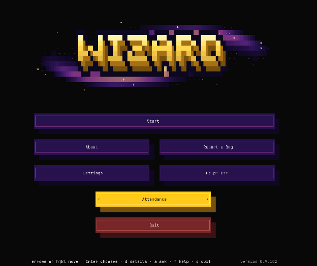
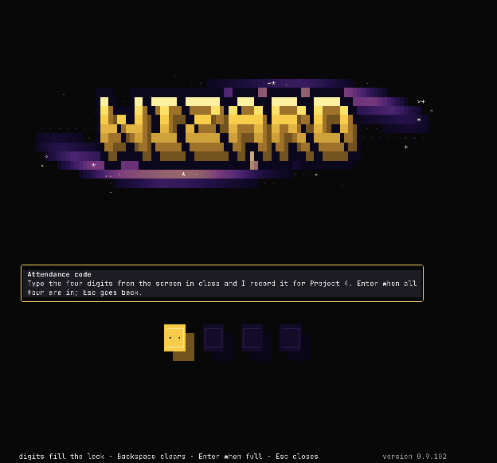

# **Project 6 setup guide**

This document sets up your computer for CSE490’s in-class projects. There are two ways to do it, and they end in the same place. Pick one.

## **Option 1: the wizard (recommended)**

A small program that walks you through each step, with a picture of where to click, and checks each one on your computer. Download it once; every week it fetches that week’s project by itself. Requires Python 3.9+.  
Download [wizard-cse490.zip](https://github.com/cse490A2/cse490-published/releases/download/wizard/wizard-cse490.zip). It lands in your Downloads folder.

### **Mac**

Double-click the zip in Downloads to get the wizard folder. Then, in Terminal:  
`cd ~/Downloads/wizard`  
`python3 wizard.py`

### **Windows**

Right-click the zip in Downloads, choose "Extract All", open the wizard folder it makes, and double-click SETUP-WINDOWS.bat. If the blue "Windows protected your PC" box appears: "More info", then "Run anyway".

### **Linux**

Unzip it in Downloads to get the wizard folder. Then, in a terminal:  
`cd ~/Downloads/wizard`  
`python3 wizard.py`

## **Option 2: by hand**

Do each step below yourself; they are the same steps the wizard walks. Every step ends with a check that says what you should see.  
The steps below are written once for every computer. Where a command differs, each computer’s line is labelled: Mac; Linux; Windows inside Ubuntu. On Windows, do the Windows-only step first; from then on every command runs in the Ubuntu terminal.

### **Part A: attendance (in class)**

#### **Mark for attendance**

Your in-person attendance is worth 2 points of your assignment grade. There are two ways to mark attendance, both using the Wizard:

##### **A. Wizard TUI**

> 1. In your terminal (on Windows, PowerShell):  
>    `python3 wizard.py`

**What am I typing?**

| What you type | What it means | From |
| :---- | :---- | :---- |
| `python3 wizard.py` | The course setup wizard. |  |
| `python3` | an interpreted, interactive, object-oriented programming language. | [man `python3`](https://docs.python.org/3/using/cmdline.html) |
| `wizard.py` | The course setup wizard. | `wizard.py` \--help |

> 2. Choose Attendance

   

> 3. Type in the attendance code, then press enter

   

> 4. Confirmation message

   

##### **B. Wizard CLI**

`python3 wizard.py attendance <code>`  
**What am I typing?**

| What you type | What it means | From |
| :---- | :---- | :---- |
| `python3 wizard.py attendance <code>` | Record your attendance. |  |
| `python3` | an interpreted, interactive, object-oriented programming language. | [man `python3`](https://docs.python.org/3/using/cmdline.html) |
| `wizard.py` | The course setup wizard. | `wizard.py` \--help |
| attendance | Record your attendance. |  |
| \<code\> | the attendance code shown in class |  |

### **Part B: Windows only**

#### **Ubuntu under WSL (Windows only)**

`thumbor`, the code you fix this week, builds on Linux and macOS and not on Windows. So on Windows the project runs inside Ubuntu, a Linux that runs beside Windows (WSL 2). Everything from step 1 on happens in the Ubuntu terminal; VS Code and your browser on Windows open straight into it.

> 1. Open PowerShell from the Start menu and run `wsl` \--install \-d Ubuntu-24.04. If it asks to restart, restart.  
> 2. Open "Ubuntu 24.04" from the Start menu. It asks once for a user name (short, lowercase letters) and a password. This window is your Ubuntu terminal from now on.  
> 3. In it, install what `thumbor` needs, one line, a few minutes:  
>    `sudo apt-get update && sudo apt-get install -y python3 python3-venv python3-dev build-essential libcurl4-openssl-dev libssl-dev libcairo2 libjpeg-turbo-progs gifsicle ffmpeg redis-server git gh curl unzip ca-certificates wslu xdg-utils`

**What am I typing?**

| What you type | What it means | From |
| :---- | :---- | :---- |
| **sudo** `apt-get` **update && sudo** `apt-get` **install \-y** `python3`**…** | update is used to resynchronize the package index files from their sources. Then: install is followed by one or more packages desired for installation or upgrading. |  |
| sudo | execute a command as another user. | [man sudo](https://www.sudo.ws/docs/man/sudo.man/) |
| `apt-get` | APT package handling utility. | [man `apt-get`](https://manpages.ubuntu.com/manpages/noble/man8/apt-get.8.html) |
| update | update is used to resynchronize the package index files from their sources. |  |
| && | command1 && command2: command2 is executed if, and only if, command1 returns an exit status of zero. | [man bash](https://man7.org/linux/man-pages/man1/bash.1.html) |
| install | install is followed by one or more packages desired for installation or upgrading. |  |
| \-y | (--yes, \--assume-yes) Automatic yes to prompts; assume "yes" as answer to all prompts and run non-interactively. |  |
| `python3` | interactive high-level object-oriented language (default `python3` version) | [packages.ubuntu.com](https://packages.ubuntu.com/noble/python3) |
| python3-venv | venv module for `python3` (default `python3` version) | [packages.ubuntu.com](https://packages.ubuntu.com/noble/python3-venv) |
| python3-dev | header files and a static library for Python (default) | [packages.ubuntu.com](https://packages.ubuntu.com/noble/python3-dev) |
| build-essential | Informational list of build-essential packages: the C compiler, make and the C library headers | [packages.ubuntu.com](https://packages.ubuntu.com/noble/build-essential) |
| libcurl4-openssl-dev | development files and documentation for libcurl (OpenSSL flavour) | [packages.ubuntu.com](https://packages.ubuntu.com/noble/libcurl4-openssl-dev) |
| libssl-dev | Secure Sockets Layer toolkit – development files | [packages.ubuntu.com](https://packages.ubuntu.com/noble/libssl-dev) |
| libcairo2 | Cairo 2D vector graphics library | [packages.ubuntu.com](https://packages.ubuntu.com/noble/libcairo2) |
| libjpeg-turbo-progs | Programs for manipulating JPEG files | [packages.ubuntu.com](https://packages.ubuntu.com/noble/libjpeg-turbo-progs) |
| `gifsicle` | Tool for manipulating GIF images | [packages.ubuntu.com](https://packages.ubuntu.com/noble/gifsicle) |
| `ffmpeg` | Tools for transcoding, streaming and playing of multimedia files | [packages.ubuntu.com](https://packages.ubuntu.com/noble/ffmpeg) |
| redis-server | Persistent key-value database with network interface | [packages.ubuntu.com](https://packages.ubuntu.com/noble/redis-server) |
| git | fast, scalable, distributed revision control system | [packages.ubuntu.com](https://packages.ubuntu.com/noble/git) |
| `gh` | GitHub CLI, GitHub's official command line tool | [packages.ubuntu.com](https://packages.ubuntu.com/noble/gh) |
| `curl` | command line tool for transferring data with URL syntax | [packages.ubuntu.com](https://packages.ubuntu.com/noble/curl) |
| unzip | De-archiver for .zip files | [packages.ubuntu.com](https://packages.ubuntu.com/noble/unzip) |
| ca-certificates | Common CA certificates | [packages.ubuntu.com](https://packages.ubuntu.com/noble/ca-certificates) |
| wslu | collection of utilities for Windows Subsystem for Linux | [packages.ubuntu.com](https://packages.ubuntu.com/noble/wslu) |
| xdg-utils | desktop integration utilities from freedesktop.org | [packages.ubuntu.com](https://packages.ubuntu.com/noble/xdg-utils) |

> 4. Copy the wizard folder into Ubuntu's home, your Windows user name in place of \<you\>:  
>    `mkdir -p ~/wizard && cp -r /mnt/c/Users/<you>/Downloads/wizard/. ~/wizard/`

**What am I typing?**

| What you type | What it means | From |
| :---- | :---- | :---- |
| **mkdir \-p** `~/wizard` **&& cp \-r** `/mnt/c`**/Users/\<you\>/Downloads…** | make directories. Then: copy files. |  |
| mkdir | make directories. | [man mkdir](https://man7.org/linux/man-pages/man1/mkdir.1.html) |
| \-p | Create intermediate directories as required. |  |
| `~/wizard` | the directory to create |  |
| && | command1 && command2: command2 is executed if, and only if, command1 returns an exit status of zero. | [man bash](https://man7.org/linux/man-pages/man1/bash.1.html) |
| cp | copy files. | [man cp](https://man7.org/linux/man-pages/man1/cp.1.html) |
| \-r | (same as \-R) If source\_file designates a directory, cp copies the directory and the entire subtree connected at that point. |  |
| `/mnt/c`/Users/\<you\>/Downloads/wizard/. | source\_file; a trailing /. names the directory's contents (\<you\>: your Windows user name) |  |
| `~/wizard`/ | target |  |

> 5. In VS Code on Windows, install the extension named WSL (by Microsoft).

**Check.** In the Ubuntu terminal run `python3 --version` and `gh` \--version. You should see Python 3.12 and `gh` version 2\. Then `cd ~/wizard && code .` opens VS Code with "WSL: Ubuntu-24.04" in its bottom-left corner.  
**Troubleshooting**

> * *`wsl` \--install stops with words about the Virtual Machine Platform.* Virtualization is off in the laptop's firmware. Restart into the BIOS or UEFI settings, turn on Intel VT-x or AMD-V (sometimes called SVM), and run the line again.  
> * *`apt-get` cannot resolve archive.ubuntu.com.* Ubuntu lost its network after a VPN change. In PowerShell run `wsl --shutdown`, open Ubuntu again, and run the apt line again.  
> * *You already have Ubuntu 22.04.* Its Python is 3.10, too old for thumbor. Install 24.04 beside it with the same line; both can exist.  
> * *VS Code opened your Windows files.* Run `code .` from the Ubuntu terminal, or click the green button at VS Code's bottom left and pick Connect to WSL.

Keep the project in Ubuntu's home, never under `/mnt/c`: builds there are slow and the Python environment breaks. Your Ubuntu files show in File Explorer under Linux.

### **Part 1: harness, repository, code**

#### **1\. Your Project 5 harness**

Project 6 runs in a folder of its own on this computer, `p06`, with the harness you built in Projects 3 to 5 inside it: `harness.py`, `systemprompt.md` and your skills folder. They are in your Project 5 codespace. This step copies them down and points the harness at the course gateway; from this project on it does not use Purple.

> 1. Make a folder named `p06` and open a terminal in it.  
> 2. If `gh --version` does not answer, install the GitHub command line. Then sign in: GitHub.com, HTTPS, with a web browser.  
>    `# Mac`  
>    `brew install gh`  
>    `# Linux, and Windows inside Ubuntu`  
>    `sudo apt-get install -y gh`  
>    `gh auth login`

**What am I typing?**

| What you type | What it means | From |
| :---- | :---- | :---- |
| `brew install gh` | Install a formula or cask. |  |
| `brew` | The Missing Package Manager for macOS. | [man `brew`](https://docs.brew.sh/Manpage) |
| install | Install a formula or cask. |  |
| `gh` | GitHub command-line tool | [formulae.brew.sh](https://formulae.brew.sh/formula/gh) |
| `sudo apt-get install -y gh` | install is followed by one or more packages desired for installation or upgrading. |  |
| sudo | execute a command as another user. | [man sudo](https://www.sudo.ws/docs/man/sudo.man/) |
| `apt-get` | APT package handling utility. | [man `apt-get`](https://manpages.ubuntu.com/manpages/noble/man8/apt-get.8.html) |
| install | install is followed by one or more packages desired for installation or upgrading. |  |
| \-y | (--yes, \--assume-yes) Automatic yes to prompts; assume "yes" as answer to all prompts and run non-interactively. |  |
| `gh` | GitHub CLI, GitHub's official command line tool | [packages.ubuntu.com](https://packages.ubuntu.com/noble/gh) |
| `gh auth login` | Log in to a GitHub account. |  |
| `gh` | GitHub CLI: work seamlessly with GitHub from the command line. | [`gh` \--help](https://cli.github.com/manual/gh) |
| auth login | Log in to a GitHub account. | [`gh auth login` \--help](https://cli.github.com/manual/gh_auth_login) |

> 3. Copy the harness down. Your codespace's name is at https://github.com/codespaces, two words and a code, like orange-yodel-576g7xq5rpj344r:  
>    `gh codespace cp -e -r -c <codespace> remote:/workspaces/cse490-p05-starter/harness .`  
>    `mv harness/* . && rmdir harness`

**What am I typing?**

| What you type | What it means | From |
| :---- | :---- | :---- |
| `gh` **codespace cp \-e \-r \-c \<codespace\> remote:/workspaces…** | Copy files between local and remote file systems. |  |
| `gh` | GitHub CLI: work seamlessly with GitHub from the command line. | [`gh` \--help](https://cli.github.com/manual/gh) |
| codespace cp | Copy files between local and remote file systems. | [`gh` codespace cp \--help](https://cli.github.com/manual/gh_codespace_cp) |
| \-e | (--expand) Expand remote file names on remote shell. |  |
| \-r | (--recursive) Recursively copy directories. |  |
| \-c | (--codespace=) Name of the codespace. |  |
| \<codespace\> | your codespace's name, from github.com/codespaces |  |
| remote:/workspaces/cse490-p05-starter/harness | a source path; remote: prefixes a path inside the codespace |  |
| . | the destination; . is the current directory on this computer |  |
| `mv harness/* . && rmdir harness` | move files. Renames the file named by the source operand to the destination path named by the target operand. Then: remove directories. Removes the directory entry specified by each directory argument, provided it is empty. |  |
| mv | move files. Renames the file named by the source operand to the destination path named by the target operand. | [man mv](https://man7.org/linux/man-pages/man1/mv.1.html) |
| harness/\* | source; a trailing /\* names everything inside the directory |  |
| . | target directory; . is the current directory |  |
| && | command1 && command2: command2 is executed if, and only if, command1 returns an exit status of zero. | [man bash](https://man7.org/linux/man-pages/man1/bash.1.html) |
| rmdir | remove directories. Removes the directory entry specified by each directory argument, provided it is empty. | [man rmdir](https://man7.org/linux/man-pages/man1/rmdir.1.html) |
| harness | the directory |  |

`RULES.md` may come along; leave it, the handout replaces it.

> 4. Make a file named `.env` in `p06`, your course key from Project 3 in place of \<your course key\>:  
>    `LITELLM_BASE_URL=https://llmproxy.cs.washington.edu`  
>    `LITELLM_API_KEY=<your course key>`

**What am I typing?**

| What you type | What it means | From |
| :---- | :---- | :---- |
| `LITELLM_BASE_URL=https://llmproxy.cs.washington.edu` | A line of the `.env` file: a name and its value. |  |
| `LITELLM_BASE_URL` | the address the harness sends requests to: the course gateway |  |
| \= | sets it to |  |
| https://llmproxy.cs.washington.edu | the value |  |
| `LITELLM_API_KEY=<your course key>` | A line of the `.env` file: a name and its value. |  |
| `LITELLM_API_KEY` | the key the gateway accepts, sent as the Authorization: Bearer header |  |
| \= | sets it to |  |
| \<your course key\> | the course gateway key you were given in Project 3 |  |

> 5. Give the harness its own Python environment, 3.10 or newer (the Mac's built-in `python3` is 3.9):  
>    `# Mac`  
>    `python3.12 -m venv .venv-harness && .venv-harness/bin/pip install python-dotenv mcp requests`  
>    `# Linux, and Windows inside Ubuntu`  
>    `python3 -m venv .venv-harness && .venv-harness/bin/pip install python-dotenv mcp requests`

**What am I typing?**

| What you type | What it means | From |
| :---- | :---- | :---- |
| `python3.12` **\-m venv** `.venv-harness` **&&** `.venv-harness`**/bin/p…** | venv: Creates virtual Python environments in one or more target directories. Then: Install packages from PyPI, VCS project urls, local project directories, or local or remote source archives. |  |
| `python3.12` | an interpreted, interactive, object-oriented programming language. | [man `python3`](https://docs.python.org/3/using/cmdline.html) |
| \-m venv | venv: Creates virtual Python environments in one or more target directories. | [python \-m venv \--help](https://docs.python.org/3/library/venv.html) |
| `.venv-harness` | a directory to create the environment in |  |
| && | command1 && command2: command2 is executed if, and only if, command1 returns an exit status of zero. | [man bash](https://man7.org/linux/man-pages/man1/bash.1.html) |
| `.venv-harness`/bin/`pip` | `pip`: the Python package installer. | [`pip` \--help](https://pip.pypa.io/en/stable/cli/) |
| install | Install packages from PyPI, VCS project urls, local project directories, or local or remote source archives. | [`pip` install \--help](https://pip.pypa.io/en/stable/cli/pip_install/) |
| `python-dotenv` | Read key-value pairs from a `.env` file and set them as environment variables | [pypi.org](https://pypi.org/project/python-dotenv/) |
| `mcp` | Model Context Protocol SDK | [pypi.org](https://pypi.org/project/mcp/) |
| requests | Python HTTP for Humans. | [pypi.org](https://pypi.org/project/requests/) |
| `python3` **\-m venv** `.venv-harness` **&&** `.venv-harness`**/bin/**`pip`**…** | venv: Creates virtual Python environments in one or more target directories. Then: Install packages from PyPI, VCS project urls, local project directories, or local or remote source archives. |  |
| `python3` | an interpreted, interactive, object-oriented programming language. | [man `python3`](https://docs.python.org/3/using/cmdline.html) |
| \-m venv | venv: Creates virtual Python environments in one or more target directories. | [python \-m venv \--help](https://docs.python.org/3/library/venv.html) |
| `.venv-harness` | a directory to create the environment in |  |
| && | command1 && command2: command2 is executed if, and only if, command1 returns an exit status of zero. | [man bash](https://man7.org/linux/man-pages/man1/bash.1.html) |
| `.venv-harness`/bin/`pip` | `pip`: the Python package installer. | [`pip` \--help](https://pip.pypa.io/en/stable/cli/) |
| install | Install packages from PyPI, VCS project urls, local project directories, or local or remote source archives. | [`pip` install \--help](https://pip.pypa.io/en/stable/cli/pip_install/) |
| `python-dotenv` | Read key-value pairs from a `.env` file and set them as environment variables | [pypi.org](https://pypi.org/project/python-dotenv/) |
| `mcp` | Model Context Protocol SDK | [pypi.org](https://pypi.org/project/mcp/) |
| requests | Python HTTP for Humans. | [pypi.org](https://pypi.org/project/requests/) |

From here on, run the harness with `.venv-harness`/bin/python harness.py.

> 6. If your Project 5 harness was pointed at Purple, ask the LiteLLM chat in VS Code: "Point `harness.py` at the course gateway: at startup load `.env` beside it, read `LITELLM_BASE_URL` and `LITELLM_API_KEY` from it, send the key as an Authorization: Bearer header, and use the model external/haiku-5-5. Change nothing else." Read the change before you accept it.

**Check.** Off campus, connect the UW VPN (Husky OnNet) first. Run `.venv-harness/bin/python harness.py` and type: Say hello in five words. You should get a short reply from the model. Ctrl+C stops it.  
**Troubleshooting**

> * *Could not resolve host, or it hangs.* You are off campus without the VPN. Connect Husky OnNet and try again.  
> * *401\.* The key in `.env` is wrong or has a stray space, or the harness still sends it the Purple way (an api-key header). The gateway wants Authorization: Bearer.  
> * *`gh` says there is no codespace, or the copy prints nothing for minutes.* Start the codespace once at https://github.com/codespaces and run the copy again. If it fails twice, download `harness.py`, `systemprompt.md` and the skills folder from the codespace's Explorer (right-click, Download) into p06. A `gh` signed in before Project 5 may need `gh auth refresh -s codespace` first.  
> * *The harness looks for pedia.py or SPEC.md.* `systemprompt.md` still carries Project 3 and 4 lines. Remove them; keep your own rules.

#### **2\. Your repository**

Project 6 happens in a repository of your own: a private copy of `thumbor` named p06-\<your login\> under your GitHub account, as `thumbor` was in September 2026, with its full history and five issues filed (four real reports with their conversations, one planted feature). A copy made from a template has no link back to the course starter, so your pull requests stay in your repository and nothing needs the course organisation's approval.

> 1. Make the repository from the course template, your GitHub login in place of \<your login\>:  
>    `gh repo create p06-<your login> --private --template cse490A2/cse490-p06-starter`

**What am I typing?**

| What you type | What it means | From |
| :---- | :---- | :---- |
| `gh` **repo create p06-\<your login\> \--private \--template cs…** | Create a new repository on GitHub. |  |
| `gh` | GitHub CLI: work seamlessly with GitHub from the command line. | [`gh` \--help](https://cli.github.com/manual/gh) |
| repo create | Create a new repository on GitHub. | [`gh` repo create \--help](https://cli.github.com/manual/gh_repo_create) |
| p06-\<your login\> | the name of the new repository (\<your login\>: your GitHub user name) |  |
| \--private | Make the new repository private. |  |
| \--template | (--template=) Make the new repository based on a template repository. |  |
| cse490A2/cse490-p06-starter | the value for \--template |  |

> 2. Wait until https://github.com/\<your login\>/p06-\<your login\> shows files. GitHub copies the template in the background, about a minute.  
> 3. Run the course script that pushes `thumbor`'s history, files the five issues and invites the grader. It is in the wizard folder, which fetches the `p06` pack the first time the wizard runs with Project 6 open (`python3 wizard.py`, pick Project 6, quit):  
>    `# Mac and Linux`  
>    `python3 ~/Downloads/wizard/packs/p06/10-repo/make_repo.py`  
>    `# Windows inside Ubuntu`  
>    `python3 ~/wizard/packs/p06/10-repo/make_repo.py`

**What am I typing?**

| What you type | What it means | From |
| :---- | :---- | :---- |
| `python3` **\~/Downloads/wizard/packs/**`p06`**/10-repo/make\_repo.…** | the Python script to run |  |
| `python3` | an interpreted, interactive, object-oriented programming language. | [man `python3`](https://docs.python.org/3/using/cmdline.html) |
| \~/Downloads/wizard/packs/`p06`/10-repo/make\_repo.py | the Python script to run |  |
| `python3 ~/wizard/packs/p06/10-repo/make_repo.py` | the Python script to run |  |
| `python3` | an interpreted, interactive, object-oriented programming language. | [man `python3`](https://docs.python.org/3/using/cmdline.html) |
| `~/wizard`/packs/`p06`/10-repo/make\_repo.py | the Python script to run |  |

It prints each step; the history push takes about a minute.  
**Check.** Open https://github.com/\<your login\>/p06-\<your login\>/issues: five issues labelled menu, four with comments copied from thumbor. On the Code tab the commit count is in the thousands, not 1\.  
**Troubleshooting**

> * *`gh` repo create says the name already exists.* Fine. Run the script; it adds only what is missing.  
> * *The repository is there but empty.* GitHub is still copying. Wait a minute and look again.  
> * *The script made the repository under another account.* It goes under the signed-in one. `gh auth login` again as the account you want.  
> * *The commit count is 1\.* git was missing when the script ran. Install git and run the script again.

#### **3\. GitHub token**

Your harness needs a key of its own to the repository: a fine-grained personal access token that can reach p06-\<your login\> and nothing else. Its owner must be your own account; a token owned by the course organisation needs an administrator's approval, yours needs nobody's. GitHub shows it once, and it lives in `.env` beside your harness.

> 1. Open https://github.com/settings/personal-access-tokens/new (Settings, Developer settings, Personal access tokens, Fine-grained tokens, Generate new token).  
> 2. Token name cse490-p06. Expiration 90 days. Resource owner: your own account, not cse490A2.  
> 3. Repository access: "Only select repositories", pick p06-\<your login\>. One repository.  
> 4. Repository permissions: Contents, Issues and Pull requests to Read and write. Leave the rest at No access; Metadata becomes Read on its own.  
> 5. Generate token, and copy the whole string. It starts with github\_pat\_.  
> 6. Add it to `.env` in `p06`:  
>    `GITHUB_PERSONAL_ACCESS_TOKEN=<your token>`

**What am I typing?**

| What you type | What it means | From |
| :---- | :---- | :---- |
| `GITHUB_PERSONAL_ACCESS_TOKEN=<your token>` | A line of the `.env` file: a name and its value. |  |
| `GITHUB_PERSONAL_ACCESS_TOKEN` | the token the GitHub MCP server sends with every request |  |
| \= | sets it to |  |
| \<your token\> | the fine-grained token GitHub showed you once |  |

**Check.** In `p06`:  
`curl -s -H "Authorization: Bearer $(grep GITHUB_PERSONAL_ACCESS_TOKEN .env | cut -d= -f2)" https://api.github.com/user/repos | grep full_name`  
**What am I typing?**

| What you type | What it means | From |
| :---- | :---- | :---- |
| `curl` **\-s \-H "Authorization: Bearer \$(grep GITHUB\_PERSONA…** | transfer a URL. Then: file pattern searcher. |  |
| `curl` | transfer a URL. | [man `curl`](https://curl.se/docs/manpage.html) |
| \-s | (--silent) Silent or quiet mode. Do not show progress meter or error messages. |  |
| \-H | (--header=) Extra header to include in the request when sending HTTP to a server. |  |
| "Authorization: Bearer \$(grep `GITHUB_PERSONAL_ACCESS_TOKEN` `.env` ¦ cut \-d= \-f2)" | the header value: the word Bearer, then your key; the \$( ) part reads the key out of `.env` |  |
| https://api.github.com/user/repos | the URL to transfer |  |
| ¦ | The vertical bar (shown in this table as ¦): The standard output of command1 is connected via a pipe to the standard input of command2. | [man bash](https://man7.org/linux/man-pages/man1/bash.1.html) |
| grep | file pattern searcher. | [man grep](https://man7.org/linux/man-pages/man1/grep.1.html) |
| full\_name | the pattern |  |

You should see exactly one line, and it names \<your login\>/p06-\<your login\>. No line means the token is wrong; two or more means it reaches other repositories.  
**Troubleshooting**

> * *No line.* A character was lost when pasting, or the page was closed before copying (the token cannot be shown again). Make a new token and paste it whole.  
> * *More than one line.* "All repositories" or several were picked. Delete that token on github.com and make one with only p06-\<your login\>.  
> * *You used `gh auth token` instead.* That token reaches everything you have. Make the fine-grained one above.  
> * *The resource owner list shows cse490A2.* Pick your own account anyway. The repository is yours.

#### **4\. GitHub MCP server**

The GitHub MCP server is the program that gives your harness GitHub's tools: read an issue, open a pull request, post a review. It is the same kind of server as Blender's in Project 5, one file released by GitHub (release 2.0.2). Your harness starts it with `github-mcp-server stdio` and hands it your token from .env. `settings.json` names the server, and the git commands and GitHub tools the harness must refuse; in the handout's step 3 it replaces Project 5's RULES.md.

> 1. In `p06`, download and unpack the server:  
>    `# Mac`  
>    `curl -L -o mcp.tar.gz https://github.com/github/github-mcp-server/releases/download/v2.0.2/github-mcp-server_Darwin_$(uname -m).tar.gz && tar -xzf mcp.tar.gz github-mcp-server`  
>    `# Linux, and Windows inside Ubuntu`  
>    `curl -L -o mcp.tar.gz https://github.com/github/github-mcp-server/releases/download/v2.0.2/github-mcp-server_Linux_x86_64.tar.gz && tar -xzf mcp.tar.gz github-mcp-server`

**What am I typing?**

| What you type | What it means | From |
| :---- | :---- | :---- |
| `curl` **\-L \-o mcp.tar.gz https://github.com/github/github-…** | transfer a URL. Then: manipulate tape archives. |  |
| `curl` | transfer a URL. | [man `curl`](https://curl.se/docs/manpage.html) |
| \-L | (--location) If the server reports that the requested page has moved to a different location, this option makes `curl` redo the request on the new place. |  |
| \-o | (--output=) Write output to \<file\> instead of stdout. |  |
| mcp.tar.gz | the value for \-o |  |
| https://github.com/github/`github-mcp-server`/releases/download/v2.0.2/github-mcp-server\_Darwin\_\$(uname \-m).tar.gz | the URL to transfer |  |
| && | command1 && command2: command2 is executed if, and only if, command1 returns an exit status of zero. | [man bash](https://man7.org/linux/man-pages/man1/bash.1.html) |
| tar | manipulate tape archives. | [man tar](https://man7.org/linux/man-pages/man1/tar.1.html) |
| \-xzf | \-x Extract to disk from the archive. \-z Filter the archive through gzip. \-f Read the archive from the specified file. |  |
| mcp.tar.gz | the archive file |  |
| `github-mcp-server` | a member to extract (the rest stays in the archive) |  |
| `curl` **\-L \-o mcp.tar.gz https://github.com/github/github-…** | transfer a URL. Then: manipulate tape archives. |  |
| `curl` | transfer a URL. | [man `curl`](https://curl.se/docs/manpage.html) |
| \-L | (--location) If the server reports that the requested page has moved to a different location, this option makes `curl` redo the request on the new place. |  |
| \-o | (--output=) Write output to \<file\> instead of stdout. |  |
| mcp.tar.gz | the value for \-o |  |
| https://github.com/github/`github-mcp-server`/releases/download/v2.0.2/github-mcp-server\_Linux\_x86\_64.tar.gz | the URL to transfer |  |
| && | command1 && command2: command2 is executed if, and only if, command1 returns an exit status of zero. | [man bash](https://man7.org/linux/man-pages/man1/bash.1.html) |
| tar | manipulate tape archives. | [man tar](https://man7.org/linux/man-pages/man1/tar.1.html) |
| \-xzf | \-x Extract to disk from the archive. \-z Filter the archive through gzip. \-f Read the archive from the specified file. |  |
| mcp.tar.gz | the archive file |  |
| `github-mcp-server` | a member to extract (the rest stays in the archive) |  |

> 2. Make a file named `settings.json` in `p06`, beside harness.py. The token's value stays in `.env`; this file names only the variable:  
>    `{`  
>      `"mcpServers": {`  
>        `"github": {`  
>          `"command": "./github-mcp-server",`  
>          `"args": ["stdio"],`  
>          `"env": {"GITHUB_PERSONAL_ACCESS_TOKEN": "${GITHUB_PERSONAL_ACCESS_TOKEN}"}`  
>        `}`  
>      `},`  
>      `"permissions": {`  
>        `"deny": [`  
>          `"git push origin main", "git push --force", "git push -f",`  
>          `"create_or_update_file", "push_files", "delete_file"`  
>        `]`  
>      `}`  
>    `}`

The deny list is three git commands and the three GitHub tools that write to a repository without a pull request.  
**Check.** In `p06`:  
`./github-mcp-server --version`  
`python3 -c "import json; json.load(open('settings.json')); print('settings.json ok')"`  
**What am I typing?**

| What you type | What it means | From |
| :---- | :---- | :---- |
| `./github-mcp-server --version` | `github-mcp-server`: GitHub MCP Server, the program your harness starts to reach GitHub. |  |
| ./`github-mcp-server` | `github-mcp-server`: GitHub MCP Server, the program your harness starts to reach GitHub. | [`github-mcp-server` \--help](https://github.com/github/github-mcp-server#readme) |
| \--version | version for `github-mcp-server` |  |
| `python3` **\-c "import json; json.load(open('**`settings.json`**'…** | an interpreted, interactive, object-oriented programming language. |  |
| `python3` | an interpreted, interactive, object-oriented programming language. | [man `python3`](https://docs.python.org/3/using/cmdline.html) |
| \-c | (-c command) Specify the command to execute. |  |
| "import json; json.load(open('`settings.json`')); print('`settings.json` ok')" | what the command works on |  |

You should see Version: 2.0.2 among the first lines, then `settings.json` ok. The first real exchange with GitHub is the handout's step 3c, when your harness asks for the open issues.  
**Troubleshooting**

> * *macOS says it cannot be opened.* Run `xattr -d com.apple.quarantine github-mcp-server` and try again.  
> * *Permission denied.* Run `chmod +x github-mcp-server` and try again.  
> * *Expecting value, or JSONDecodeError.* A quote or comma is missing in settings.json. Compare it with the block above.  
> * *The version is not 2.0.2.* Delete the file and download from the line above again.

#### **5\. Your copy of the code**

The code your harness edits and tests is a clone of your repository inside `p06`, with its own Python environment, `.venv`, and `thumbor`'s C filters compiled into it. You do this step in class, so the first time you see `thumbor` the staff are in the room.

> 1. In `p06`, clone your repository and go in:  
>    `gh repo clone <your login>/p06-<your login>`  
>    `cd p06-<your login>`

**What am I typing?**

| What you type | What it means | From |
| :---- | :---- | :---- |
| `gh repo clone <your login>/p06-<your login>` | Clone a repository locally. |  |
| `gh` | GitHub CLI: work seamlessly with GitHub from the command line. | [`gh` \--help](https://cli.github.com/manual/gh) |
| repo clone | Clone a repository locally. | [`gh` repo clone \--help](https://cli.github.com/manual/gh_repo_clone) |
| \<your login\>/p06-\<your login\> | the repository, as OWNER/REPO (\<your login\>: your GitHub user name) |  |
| `cd p06-<your login>` | Change the current directory to dir. |  |
| `cd` | Change the current directory to dir. | [man bash (builtins)](https://man7.org/linux/man-pages/man1/bash.1.html#SHELL_BUILTIN_COMMANDS) |
| p06-\<your login\> | dir (\<your login\>: your GitHub user name) |  |

> 2. A C compiler and the Cairo library, once:  
>    `# Mac`  
>    `xcode-select --install && brew install cairo`  
>    `# Linux, and Windows inside Ubuntu`  
>    `sudo apt-get install -y build-essential python3-dev libcairo2`

**What am I typing?**

| What you type | What it means | From |
| :---- | :---- | :---- |
| `xcode-select --install && brew install cairo` | Manages the active developer directory for Xcode and BSD tools. Then: Install a formula or cask. |  |
| `xcode-select` | Manages the active developer directory for Xcode and BSD tools. | [man `xcode-select`](https://keith.github.io/xcode-man-pages/xcode-select.1.html) |
| \--install | Opens a user interface dialog to request automatic installation of the command line developer tools. |  |
| && | command1 && command2: command2 is executed if, and only if, command1 returns an exit status of zero. | [man bash](https://man7.org/linux/man-pages/man1/bash.1.html) |
| `brew` | The Missing Package Manager for macOS. | [man `brew`](https://docs.brew.sh/Manpage) |
| install | Install a formula or cask. |  |
| cairo | Vector graphics library with cross-device output support | [formulae.brew.sh](https://formulae.brew.sh/formula/cairo) |
| **sudo** `apt-get` **install \-y build-essential python3-dev lib…** | install is followed by one or more packages desired for installation or upgrading. |  |
| sudo | execute a command as another user. | [man sudo](https://www.sudo.ws/docs/man/sudo.man/) |
| `apt-get` | APT package handling utility. | [man `apt-get`](https://manpages.ubuntu.com/manpages/noble/man8/apt-get.8.html) |
| install | install is followed by one or more packages desired for installation or upgrading. |  |
| \-y | (--yes, \--assume-yes) Automatic yes to prompts; assume "yes" as answer to all prompts and run non-interactively. |  |
| build-essential | Informational list of build-essential packages: the C compiler, make and the C library headers | [packages.ubuntu.com](https://packages.ubuntu.com/noble/build-essential) |
| python3-dev | header files and a static library for Python (default) | [packages.ubuntu.com](https://packages.ubuntu.com/noble/python3-dev) |
| libcairo2 | Cairo 2D vector graphics library | [packages.ubuntu.com](https://packages.ubuntu.com/noble/libcairo2) |

> 3. Make the environment and install `thumbor` into it. It needs Python 3.12 or newer; a few minutes, the install compiles `thumbor`'s filters:  
>    `# Mac`  
>    `python3.12 -m venv .venv`  
>    `# Linux, and Windows inside Ubuntu`  
>    `python3 -m venv .venv`  
>    `source .venv/bin/activate`  
>    `python -m pip install -U pip setuptools wheel`  
>    `pip install -e ".[tests,opencv,extra-libs]"`  
>    `python setup.py build_ext -i`

**What am I typing?**

| What you type | What it means | From |
| :---- | :---- | :---- |
| `python3.12 -m venv .venv` | venv: Creates virtual Python environments in one or more target directories. |  |
| `python3.12` | an interpreted, interactive, object-oriented programming language. | [man `python3`](https://docs.python.org/3/using/cmdline.html) |
| \-m venv | venv: Creates virtual Python environments in one or more target directories. | [python \-m venv \--help](https://docs.python.org/3/library/venv.html) |
| `.venv` | a directory to create the environment in |  |
| `python3 -m venv .venv` | venv: Creates virtual Python environments in one or more target directories. |  |
| `python3` | an interpreted, interactive, object-oriented programming language. | [man `python3`](https://docs.python.org/3/using/cmdline.html) |
| \-m venv | venv: Creates virtual Python environments in one or more target directories. | [python \-m venv \--help](https://docs.python.org/3/library/venv.html) |
| `.venv` | a directory to create the environment in |  |
| `source .venv/bin/activate` | source filename: Read and execute commands from filename in the current shell environment. |  |
| source | source filename: Read and execute commands from filename in the current shell environment. | [man bash (builtins)](https://man7.org/linux/man-pages/man1/bash.1.html#SHELL_BUILTIN_COMMANDS) |
| `.venv`/bin/activate | filename; activate sets this shell's PATH to the environment's bin |  |
| `python -m pip install -U pip setuptools wheel` | `pip`: the Python package installer. |  |
| python | an interpreted, interactive, object-oriented programming language. | [man `python3`](https://docs.python.org/3/using/cmdline.html) |
| \-m `pip` | `pip`: the Python package installer. | [`pip` \--help](https://pip.pypa.io/en/stable/cli/) |
| install | what the command works on |  |
| \-U | an option of this command |  |
| `pip` setuptools wheel | an argument; 3 are listed |  |
| `pip install -e ".[tests,opencv,extra-libs]"` | Install packages from PyPI, VCS project urls, local project directories, or local or remote source archives. |  |
| `pip` | the Python package installer. | [`pip` \--help](https://pip.pypa.io/en/stable/cli/) |
| install | Install packages from PyPI, VCS project urls, local project directories, or local or remote source archives. | [`pip` install \--help](https://pip.pypa.io/en/stable/cli/pip_install/) |
| \-e | (--editable=) Install a project in editable mode (i.e. setuptools "develop mode") from a local project path or a VCS url. |  |
| ".\[tests,opencv,extra-libs\]" | the value for \-e |  |
| `python setup.py build_ext -i` | the Python script to run |  |
| python | an interpreted, interactive, object-oriented programming language. | [man `python3`](https://docs.python.org/3/using/cmdline.html) |
| setup.py | the Python script to run |  |
| build\_ext | what the command works on |  |
| \-i | an option of this command |  |

> 4. Run the suite once. It is the command in `AGENTS.md`:  
>    `python -m pytest tests -q -p no:cacheprovider -p no:tldr --ignore=tests/detectors --ignore=tests/integration_tests --deselect tests/error_handlers/test_sentry.py::SentryTestCase::test_when_error_occurs_should_have_called_client --deselect tests/loaders/test_http_loader.py::HttpCurlTimeoutLoaderTestCase::test_load_with_speed_timeout`

**What am I typing?**

| What you type | What it means | From |
| :---- | :---- | :---- |
| **python \-m pytest tests \-q \-p no:cacheprovider \-p no:tld…** | pytest: helps you write better programs. |  |
| python | an interpreted, interactive, object-oriented programming language. | [man `python3`](https://docs.python.org/3/using/cmdline.html) |
| \-m pytest | pytest: helps you write better programs. | [pytest \--help](https://docs.pytest.org/en/stable/reference/reference.html#command-line-flags) |
| tests | a file or directory to collect tests from |  |
| \-q | (--quiet) Decrease verbosity. |  |
| \-p | (-p name) Early-load given plugin module name or entry point (multi-allowed). To avoid loading of plugins, use the `no:` prefix. |  |
| no:cacheprovider | a file or directory to collect tests from |  |
| no:tldr | a file or directory to collect tests from |  |
| \--ignore=tests/detectors | (--ignore=path) Ignore path during collection (multi-allowed). |  |
| \--ignore=tests/integration\_tests | (--ignore=path) Ignore path during collection (multi-allowed). |  |
| \--deselect | (--deselect=nodeid\_prefix) Deselect item (via node id prefix) during collection (multi-allowed). |  |
| tests/error\_handlers/test\_sentry.py::SentryTestCase::test\_when\_error\_occurs\_should\_have\_called\_client | a file or directory to collect tests from |  |
| tests/loaders/test\_http\_loader.py::HttpCurlTimeoutLoaderTestCase::test\_load\_with\_speed\_timeout | a file or directory to collect tests from |  |

**Check.** The suite ends with about 700 passed in under a minute. Up to a dozen failures are the GIF and doctor tests on a laptop without `gifsicle`, `jpegtran` or `ffmpeg`; `AGENTS.md` lists them, and none is yours. Then start the server and look at a picture:  
`python -m thumbor.server -p 8888 -c course/thumbor.conf -l error`  
**What am I typing?**

| What you type | What it means | From |
| :---- | :---- | :---- |
| **python \-m thumbor.server \-p 8888 \-c** `course/thumbor.conf`**…** | `thumbor`: the image server. |  |
| python | an interpreted, interactive, object-oriented programming language. | [man `python3`](https://docs.python.org/3/using/cmdline.html) |
| \-m thumbor.server | `thumbor`: the image server. | [`thumbor` \--help](https://thumbor.readthedocs.io/en/latest/running.html) |
| \-p | (--port=) The port to run this `thumbor` instance at. |  |
| 8888 | the value for \-p |  |
| \-c | (--conf=) The path of the configuration file to use for this `thumbor` instance. |  |
| `course/thumbor.conf` | the value for \-c |  |
| \-l | (--log-level=) The log level to be used. Possible values are: debug, info, warning, error, critical or notset. |  |
| error | the value for \-l |  |

Open http://localhost:8888/unsafe/300x200/example.jpg in your browser. A picture appears. Ctrl+C stops the server.  
**Troubleshooting**

> * *`pip` stops building cairocffi or cairosvg.* Cairo is missing (step 2). Install it and run the line that stopped again.  
> * *`pip` says the Python is too old.* `thumbor` needs 3.12 or newer. Install one and make `.venv` again with it.  
> * *The server says the port is in use.* Start on another port and change only the port in the URL.  
> * *No picture.* The server was started outside the clone, or without \-c course/thumbor.conf. Start it from the clone's top folder with the line above.
