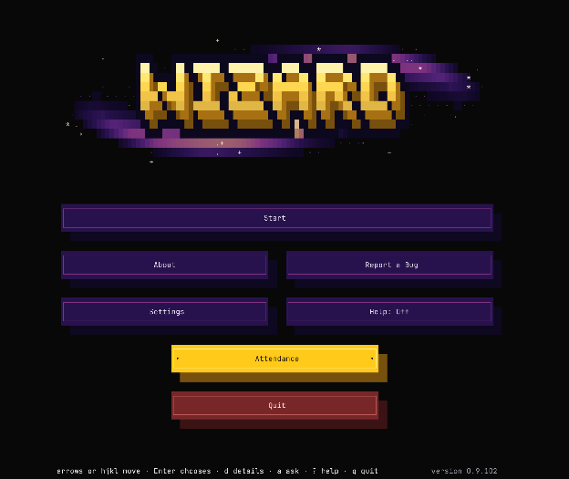
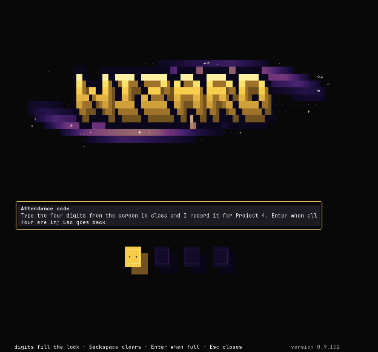
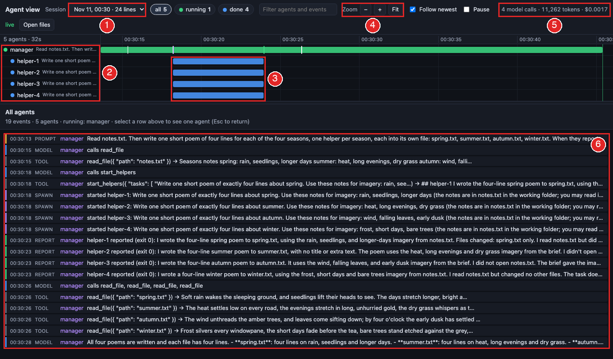

# **Project 7 setup guide**

This document sets up your computer for CSE490’s in-class projects. There are two ways to do it, and they end in the same place. Pick one.

## **Option 1: the wizard (recommended)**

Project 7 is set up by hand this week: follow Option 2 below. The wizard still marks your attendance.

A small program that walks you through each step, with a picture of where to click, and checks each one on your computer. Download it once; every week it fetches that week’s project by itself. Requires Python 3.9+.  
Download [wizard-cse490.zip](https://github.com/cse490A2/cse490-published/releases/download/wizard/wizard-cse490.zip). It lands in your Downloads folder.

### **Mac**

Double-click the zip in Downloads to get the wizard folder. Then, in Terminal:  
`cd ~/Downloads/wizard`  
`python3 wizard.py`

### **Windows**

Right-click the zip in Downloads, choose "Extract All", open the wizard folder it makes, and double-click SETUP-WINDOWS.bat. If the blue "Windows protected your PC" box appears: "More info", then "Run anyway".

### **Linux**

Unzip it in Downloads to get the wizard folder. Then, in a terminal:  
`cd ~/Downloads/wizard`  
`python3 wizard.py`

## **Option 2: by hand**

Do each step below yourself; they are the same steps the wizard walks. Every step ends with a check that says what you should see.  
The steps below are written once for every computer. Where a command differs, each computer’s line is labelled: Mac; Linux; Windows inside Ubuntu. On Windows, every command runs in the Ubuntu terminal you set up in Project 6\.

### **Part A: mark for attendance (in class)**

#### **Mark for attendance**

Your in-person attendance is worth 2 points of your assignment grade. There are two ways to mark attendance, both using the Wizard:

##### **A. Wizard TUI**

> 1. In your terminal (on Windows, PowerShell):  
>    `python3 wizard.py`

**What am I typing?**

| What you type | What it means | From |
| :---- | :---- | :---- |
| `python3 wizard.py` | The course setup wizard. |  |
| `python3` | an interpreted, interactive, object-oriented programming language. | [man `python3`](https://docs.python.org/3/using/cmdline.html) |
| `wizard.py` | The course setup wizard. | `wizard.py` \--help |

> 2. Choose Attendance

   

> 3. Type in the attendance code, then press enter

   

> 4. Confirmation message

   

##### **B. Wizard CLI**

`python3 wizard.py attendance <code>`  
**What am I typing?**

| What you type | What it means | From |
| :---- | :---- | :---- |
| `python3 wizard.py attendance <code>` | Record your attendance. |  |
| `python3` | an interpreted, interactive, object-oriented programming language. | [man `python3`](https://docs.python.org/3/using/cmdline.html) |
| `wizard.py` | The course setup wizard. | `wizard.py` \--help |
| attendance | Record your attendance. |  |
| \<code\> | the attendance code shown in class |  |

### **Setup:**

#### **1\. Download the starter files**

> 1. Download the Starter files at the top of this page, beside Handout and Setup.  
> 2. Unzip the file. Inside it is a folder named `p07_starter`, which should contain `harness` and `p07`.

###### ***Windows***

Your work is inside Ubuntu, so unzip straight into it. Right-click starter.zip and choose "Extract All". In the box, replace the folder with this one, your Ubuntu user name in place of \<name\>, then choose Extract:  
`\\wsl.localhost\Ubuntu-24.04\home\<name>`

In the Ubuntu terminal, `whoami` prints your Ubuntu user name, and the folder is `~/p07_starter`.

**Check:** The `p07_starter` folder holds `harness` and `p07`.

#### **2\. Your harness**

The starter files provide a harness to use. You can also continue to use your already-built harness.

## **Choose one:**

##### **A. Use the given starter harness**

> 1. From your Project 6 folder, copy `.env` into `~/p07_starter/harness/.env`. Make the folder `~/p07_starter/harness/mcp` (`mkdir -p ~/p07_starter/harness/mcp`), and copy `github-mcp-server` into it.  
> 2. The harness needs Python 3.12 or newer. See what `python3` is: `python3 --version`. If it says 3.12 or more, go on. If it says less (the Mac's built-in is 3.9), install a newer one with Homebrew: `brew install python@3.12`. Then type `python3.12` in place of `python3` in the next line.  
> 3. From a terminal in `p07_starter/harness`, make its Python environment:  
>    `python3 -m venv .venv-harness && .venv-harness/bin/pip install python-dotenv mcp requests`

**What am I typing?**

| What you type | What it means | From |
| :---- | :---- | :---- |
| `python3` **\-m venv** `.venv-harness` **&&** `.venv-harness`**/bin/p…** | venv: Creates virtual Python environments in one or more target directories. Then: Install packages from PyPI, VCS project urls, local project directories, or local or remote source archives. |  |
| `python3` | an interpreted, interactive, object-oriented programming language. | [man `python3`](https://docs.python.org/3/using/cmdline.html) |
| \-m venv | Creates virtual Python environments in one or more target directories. | [venv](https://docs.python.org/3/library/venv.html) |
| install | Install packages from PyPI, VCS project urls, local project directories, or local or remote source archives. | [`pip` install \--help](https://pip.pypa.io/en/stable/cli/pip_install/) |

##### **B. Use your own harness**

> 1. Replace `p07_starter/harness` with your own harness folder from Project 6; ensure it's named `harness`.

This project requires the following components you've built in previous assignments:

* A `settings.json` the harness reads when it starts.  
* Local tools such as `read_file`, `write_file`, and `execute_file`.  
* Server tools, such as the ones the GitHub MCP server adds.  
* The six names below in `harness.py`. The Project 7 tests and TOOLS.md use each one by name, so a harness that names them differently fails every test.

| Name in `harness.py` | What it is |
| :---- | :---- |
| `LOCAL_TOOLS` | The list of your tool functions. |
| `LOCAL_FUNCTIONS` | The same tools, looked up by name. |
| `run_local_tool(name, args)` | Runs one tool and returns its result as text. A tool that fails returns text that starts with `Error:`. |
| `definition(function)` | Builds what the model is told about a tool: its name, what it does and its arguments. |
| `checked(path)` | Refuses a path outside the harness folder, and refuses .env. |
| `call_model(context, tools)` | Sends the conversation to the course gateway and returns the model's message. |

You can run `p07_starter/p07/tests/verify_model_structure.py` to check if your harness is ready to be used in this project.

> 2. From a terminal in `p07_starter`, with your harness's Python environment on:  
>    `python p07/tests/verify_model_structure.py`

It prints one row per check, and under each one that fails, what to change. It ends with `ready` when every check passes. It reads your harness and never changes it.

##### **Either way**

**Check:** In a terminal in `p07_starter/harness`, turn on the environment and start the harness:  
`source .venv-harness/bin/activate`  
`python harness.py`

**What am I typing?**

| What you type | What it means | From |
| :---- | :---- | :---- |
| `source .venv-harness/bin/activate` | Read and execute commands from the file in the current shell. Turns on the harness's Python environment. | [man bash](https://man7.org/linux/man-pages/man1/bash.1.html) |
| `python harness.py` | Start your harness. |  |

After the GitHub server's own log lines it shows the `>>>` prompt. Leave with Ctrl+D.  
**Troubleshooting**

> * *python: command not found.* The environment is not on. Run the `source` line first. An environment stops working when its folder is moved or renamed: delete `.venv-harness` and make it again.  
> * *No matching distribution found for mcp.* The environment was made with a Python older than 3.10. Delete `.venv-harness`, run `brew install python@3.12`, and make the environment again with `python3.12` in place of `python3`.  
> * *ModuleNotFoundError: No module named 'mcp' or 'dotenv'.* The environment is missing a package: `.venv-harness/bin/pip install python-dotenv mcp requests`.  
> * *.env is missing LITELLM\_API\_KEY.* Your key was not copied. Copy .env from your Project 6 folder.

#### **3\. Wire your harness**

Your agent cannot reach a file outside its own folder, so a few files will need to be moved over:

> 1. From a terminal in `harness`, move `trace.py` in:  
>    `mv ../p07/trace.py .`

**What am I typing?**

| What you type | What it means | From |
| :---- | :---- | :---- |
| `mv ../p07/trace.py .` | move files. Renames the file named by the source operand to the destination path named by the target operand. |  |
| mv | move files. Renames the file named by the source operand to the destination path named by the target operand. | [man mv](https://man7.org/linux/man-pages/man1/mv.1.html) |
| ../`p07`/trace.py | source |  |
| . | the folder you are in |  |

> \[\!NOTE\] **If you're using your own harness:** wire `trace.py` into `harness.py`. Feed `TRACE.md` to an Agent to implement the trace spec into your harness.  
> 

> 2. Move the following files from p07 to your harness folder:  
>    `mv ../p07/tests .`  
>    `mv ../p07/multiagent_benchmark/questions.md .`  
>    `mv ../p07/multiagent_benchmark/job_desc .`  
>    `mv ../p07/upgrade_spec .`

**What am I typing?**

| What you type | What it means | From |
| :---- | :---- | :---- |
| `mv ../p07/tests .` | move files. Renames the file named by the source operand to the destination path named by the target operand. |  |
| mv | move files. Renames the file named by the source operand to the destination path named by the target operand. | [man mv](https://man7.org/linux/man-pages/man1/mv.1.html) |
| ../`p07`/tests | source: one test per tool, and the scorer |  |
| ../`p07`/multiagent\_benchmark/`questions.md` | source: the questions for the handout's step 3 |  |
| ../`p07`/multiagent\_benchmark/job\_desc | source: the job files for the handout's step 3 |  |
| ../`p07`/upgrade\_spec | source: TOOLS.md, SPAWN.md and TRACE.md, which your agents read in the handout |  |
| . | the folder you are in |  |

**Check.** Start your harness, give it one prompt, such as hello, and leave with Ctrl+D. Then list the folder:  
`ls`

**What am I typing?**

| What you type | What it means | From |
| :---- | :---- | :---- |
| `ls` | list directory contents. | [man ls](https://man7.org/linux/man-pages/man1/ls.1.html) |

Your `harness` folder should look like:

`harness/`  
`├── harness.py`  
`├── job_desc/`  
`│   ├── job_1.md`  
`│   └── job_2.md`  
`├── mcp/`  
`│   └── github-mcp-server`  
`├── questions.md`  
`├── settings.json`  
`├── skills/`  
`├── systemprompt.md`  
`├── tests/`  
`│   ├── test_<tool>.py        one per tool`  
`│   ├── score_benchmark.py`  
`│   └── verify_model_structure.py`  
`├── trace.jsonl               file created when you prompt your harness`  
`├── trace.py`  
`└── upgrade_spec/`  
    `├── SPAWN.md`  
    `├── TOOLS.md`  
    `└── TRACE.md`

**Troubleshooting**

> * *The harness prints \[trace\] off.* `trace.py` is not beside `harness.py`. Run line 1 again from the `harness` folder.  
> * *No `trace.jsonl` with your own harness.* The note above is not done: your `harness.py` does not call `append_trace` yet. `upgrade_spec/TRACE.md` lists the calls.  
> * *mv: No such file or directory.* The file was moved already, or `p07` is not beside harness. `ls ../p07` shows what is still there.

#### **4\. Set up the agent view**

The agent view is a graphical way to see what your harness is doing. It shows each agent the harness starts, in time order and as it happens, and what each one is doing. It works by reading `trace.jsonl`, located in `p07_starter/harness`.

> 1. Open a second terminal in `p07` and start it. Leave it running:  
>    `python3 agent_view/server.py`

**What am I typing?**

| What you type | What it means | From |
| :---- | :---- | :---- |
| `python3 agent_view/server.py` | Start the agent view. It reads `trace.jsonl` in the harness folder beside `p07`. |  |
| `python3` | an interpreted, interactive, object-oriented programming language. | [man `python3`](https://docs.python.org/3/using/cmdline.html) |
| agent\_view/`server.py` | The agent view's server. It listens on your computer alone and writes nothing. |  |

> 2. It prints a line such as `Agent view: http://localhost:8797/`. Open that address in your browser. In the line below, replace \<port\> with the number it printed.  
>    `# Mac`  
>    `open http://localhost:<port>/`  
>    `# Linux`  
>    `xdg-open http://localhost:<port>/`  
>    `# Windows inside Ubuntu`  
>    `explorer.exe http://localhost:<port>/`

**What am I typing?**

| What you type | What it means | From |
| :---- | :---- | :---- |
| `open http://localhost:<port>/` | Mac: open a file or address, as if you had double-clicked it. | [man open](https://ss64.com/mac/open.html) |
| `xdg-open http://localhost:<port>/` | Linux: opens a file or URL in the user's preferred application. | [man xdg-open](https://man7.org/linux/man-pages/man1/xdg-open.1.html) |
| `explorer.exe http://localhost:<port>/` | Windows inside Ubuntu: hands the address to Windows, which opens it in your browser. |  |

**Check.** The page opens. It will look something like the picture below:

1 current session, 2 harness agent row, 3 some agents worked at this time, 4 zoom functionality, 5 session's total model calls, tokens, and cost, 6 agent's history.

**Troubleshooting**

> * *The page says it found no trace.* Step 3's check was skipped. Give your harness one prompt, then reload the page.  
> * *Address already in use.* Another program holds the port. Start it on another: `python3 agent_view/server.py 9000`. It prints the new address, and that is the one to open.  
> * *The page shows an old session.* Pick the newest one in the session list at the top of the page.
