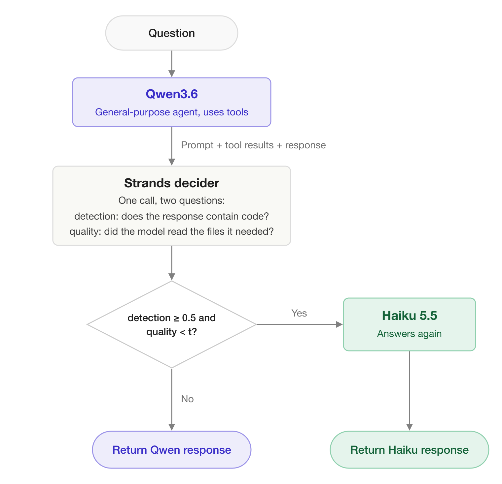
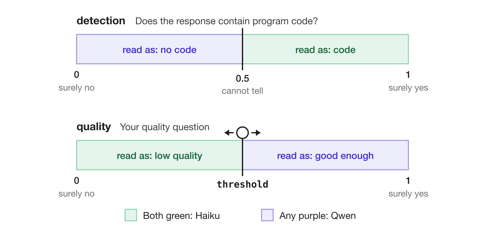

# Project 8: Model Routing

**Due: Tuesday 11:59 pm**

Prerequisites: Complete the setup guide during class.

Decision models are LLMs built to pick between given options and provide an answer much faster than a normal model. This is done by removing the part of the LLM that generates text and replacing it with a small layer that scores each option. In this project, you'll use a decision model to check every response from one model and decide whether to route the prompt to another. Your harness has a router from the setup guide that asks the decider one question. You'll change it to ask two questions in one call: 1\) does the response contain code, and 2\) is the response high quality? High quality means backed by the files the model read. A response goes to the stronger model only when it has code and is low quality. Then you'll set the router's threshold from a benchmark.

We will use Qwen 3.6 as the model that responds to all requests, and Haiku 5.5 as the stronger model.

Note: this configuration is for educational purposes to demonstrate cascade routing.

## Instructions

### 1\. Configure What the Router is Deciding

Configure the decider model to match the handout diagram above. In setup, you've hooked up the Strands decider endpoint to your harness. Your `settings.json` should look like the following:

`"router": {`  
  `"enabled": true,`  
  `"decider_url": "http://127.0.0.1:8000/v1/systemone",`  
  `"fallback_model": "external/haiku-5-5",`  
  `"threshold": 0.5,`  
  `"questions": {`  
    `"quality": {"question": "Does the response correctly and completely answer the user's question?"}`  
  `},`  
  `"timeout_seconds": 60,`  
  `"max_state_chars": 12000`  
`}`

| Setting | What it means |
| :---- | :---- |
| `enabled` | Turns the router on or off. |
| `decider_url` | The decider server's endpoint. |
| `fallback_model` | The stronger model that answers again. |
| `threshold` | The cut-off on the `quality` number. A response scoring below it can go to the stronger model. |
| `questions` | The yes/no questions the decider is asked about every response. Each has a name you choose and comes back as one number under that name. |
| `timeout_seconds` | How long the router waits for the decider before it keeps the response unchecked. |
| `max_state_chars` | How much text the decider reads in all: your prompt, the tool results and the response. |

The router reads these settings every time the model finishes a response. It sends the decider one request. The request holds the response and every question in `questions`, and the decider returns a number from 0 to 1 for each.

As in the diagram above, a response is routed to `fallback_model` when:

`detection >= 0.5 AND quality < threshold`

Your harness already includes `quality` now. You will add `detection`.

1. Currently, the router asks if a response is correct. We can make this ask more percise. Inside `harness/settings.json`, under `questions`, change the `quality` question to "Did the model read the files it needed before answering?"  
2. Add a second question beside it, named `detection`: "Does the response contain program code?"

When you are done, `questions` reads:

`"questions": {`  
  `"quality": {"question": "Did the model read the files it needed before answering?"},`  
  `"detection": {"question": "Does the response contain program code?"}`  
`},`

Using your own harness? Run `python bench/check_router.py` first. It checks that your router asks both questions.

### 2\. Verify Strands is answering two questions

Start your harness and ask it the three test prompts.

`source .venv-harness/bin/activate`  
`python harness.py`

|  | Test prompt | What it shows | Should go to |
| :---- | :---- | :---- | :---- |
| 1 | "What is the default model in `settings.json`?" | No code | Qwen |
| 2 | "Read `harness.py` and write a short Python snippet that uses its setting helper to print the router threshold." | Code backed by a file the model read | Qwen |
| 3 | "Without reading any files, write Python that calls `harness.load_router_config()` and prints the result." | Code with no file read | Haiku |

The decider's numbers vary. The purpose of these test prompts is to see the router making decisions based on its inputs and configuration. The router's boolean number should vaugly point in the correct response.

Before each response, the harness prints the decider's two numbers and what the router did:

`[router] judged detection 0.36, quality 0.31: keeping the reply.`

Open `trace.jsonl` and find the last `router_judge` line. It holds one decision in three parts.

**Decider input: the text**

| From the trace | What it is |
| :---- | :---- |
| `"question": "What is the default model in settings.json?"` | Your prompt. |
| `"tools_used": "1. read_file({\"path\":\"settings.json\"}) -> { \"model\": { \"default\": \"internal/Qwen3.6-35B-A3B\", ... [cut]"` | The tools the model used, with their results. |
| `"response": "The default model in settings.json is internal/Qwen3.6-35B-A3B."` | The model's response. |

**Decider input: the questions**

The two questions you put in `settings.json` in step 1\. They are not in the trace.

| Name | The question |
| :---- | :---- |
| `detection` | "Does the response contain program code?" |
| `quality` | "Did the model read the files it needed before answering?" |

**Decider output**

| From the trace | What it is |
| :---- | :---- |
| `"detection": 0.3553` | Its number for the `detection` question. |
| `"quality": 0.3114` | Its number for the `quality` question. |

The router then applies the rule to those two numbers. Here `detection` is below 0.5, so the response stays with Qwen whatever `quality` is.

### 3\. Set your threshold with a benchmark

The threshold determines how low `quality` must fall before a response containing code is sent to Haiku. Set it too low, and bad code stays with Qwen. Set it too high, and code that was fine is sent to Haiku unnecessarily. A small benchmark will be ran to determine a suitable threshold value.

The benchmark provides 30 saved Qwen responses: 10 with no code, 10 with code that passed its tests, and 10 with code that failed them. It reports how many of each are sent to Haiku at each threshold.

1. Run `python bench/sweep.py` from your harness folder. It saves the table to `bench/sweep.txt`.  
2. Set `router.threshold` to the row where `failed minus good` is largest. On a tie, take the lower threshold.

## Turnin

Submit the following files to the Project 8 assignment in Canvas:

1. `settings.json`, with your two questions and your threshold, and `harness.py`.  
2. `trace.jsonl`, after you run the three test prompts once more with your new threshold.  
3. `bench/sweep.txt`, the table from step 3\.

## Grading

A model will autograde your submission. It checks that the decider is asked both questions in one call about every response, that a response goes to Haiku only when `detection` is at least 0.5 and `quality` is below the threshold, that every trace record holds both numbers, and that the threshold in `settings.json` is the best one in your table. Every check is pass or fail. It does not judge your question wording or how many tries it took.

## Reference

The decider is a small model that compares a response against the text it is shown. It cannot run code or check a calculation. It reads about 12,000 characters at most, and the end of a long response.

The setup guide's step 5 shows what the router sends the decider and what comes back. Its Appendix C lists the router's settings and fixes.

If the decider server won't start, pair with a neighbour and submit your own harness with their trace and `bench/sweep.txt`. If your gateway key fails, submit what ran and rerun the Haiku side by the deadline.

### Sources

The benchmark's 30 questions come from two public datasets:

1. Code problems: N. Jain et al., "LiveCodeBench: Holistic and Contamination Free Evaluation of Large Language Models for Code", 2024\. [arXiv:2403.07974](https://arxiv.org/abs/2403.07974). Dataset: [livecodebench/code\_generation\_lite](https://huggingface.co/datasets/livecodebench/code_generation_lite), licence CC. Its problems come from LeetCode and AtCoder.  
2. Questions with no code: M-A-P Team et al., "SuperGPQA: Scaling LLM Evaluation across 285 Graduate Disciplines", 2025\. [arXiv:2502.14739](https://arxiv.org/abs/2502.14739). Dataset: [m-a-p/SuperGPQA](https://huggingface.co/datasets/m-a-p/SuperGPQA), licence ODC-BY.
