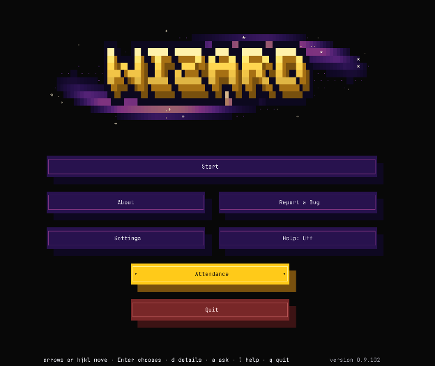
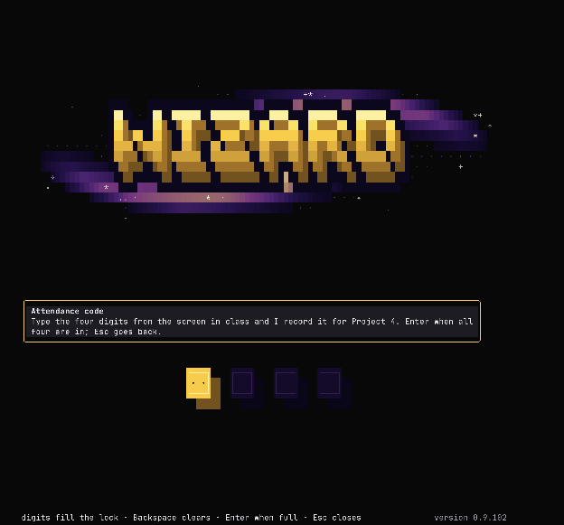
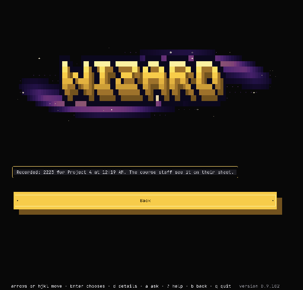

# **Project 8 setup guide**

This document sets up your computer for CSE490’s in-class projects. There are two ways to do it, and they end in the same place. Pick one.

## **Option 1: the wizard (recommended)**

A small program that walks you through each step, with a picture of where to click, and checks each one on your computer. Download it once; every week it fetches that week’s project by itself. Requires Python 3.9+.  
Download [wizard-cse490.zip](https://github.com/cse490A2/cse490-published/releases/download/wizard/wizard-cse490.zip). It lands in your Downloads folder.

### **Mac**

Double-click the zip in Downloads to get the wizard folder. Then, in Terminal:  
`cd ~/Downloads/wizard`  
`python3 wizard.py`

### **Windows**

Right-click the zip in Downloads, choose "Extract All", open the wizard folder it makes, and double-click SETUP-WINDOWS.bat. If the blue "Windows protected your PC" box appears: "More info", then "Run anyway".

### **Linux**

Unzip it in Downloads to get the wizard folder. Then, in a terminal:  
`cd ~/Downloads/wizard`  
`python3 wizard.py`

### **Lab computer**

Set up by hand here. Follow Option 2 below.

## **Option 2: by hand**

Do each step below yourself; they are the same steps the wizard walks. Every step ends with a check that says what you should see.  
The steps below are written once for every computer. Where a command differs, each computer’s line is labelled: Mac; Linux; Windows inside Ubuntu. On Windows, every command runs in the Ubuntu terminal you set up in Project 6\.

### **Part A: mark for attendance (in class)**

#### **Mark for attendance**

Your in-person attendance is worth 2 points of your assignment grade. There are two ways to mark attendance, both using the Wizard:

##### **A. Wizard TUI**

> 1. In your terminal (on Windows, PowerShell):  
>    `python3 wizard.py`

**What am I typing?**

| What you type | What it means | From |
| :---- | :---- | :---- |
| `python3 wizard.py` | The course setup wizard. |  |
| `python3` | an interpreted, interactive, object-oriented programming language. | [man `python3`](https://docs.python.org/3/using/cmdline.html) |
| `wizard.py` | The course setup wizard. | `wizard.py` \--help |

> 2. Choose Attendance

   

> 3. Type in the attendance code, then press enter

   

> 4. Confirmation message

   

##### **B. Wizard CLI**

`python3 wizard.py attendance <code>`  
**What am I typing?**

| What you type | What it means | From |
| :---- | :---- | :---- |
| `python3 wizard.py attendance <code>` | Record your attendance. |  |
| `python3` | an interpreted, interactive, object-oriented programming language. | [man `python3`](https://docs.python.org/3/using/cmdline.html) |
| `wizard.py` | The course setup wizard. | `wizard.py` \--help |
| attendance | Record your attendance. |  |
| \<code\> | the attendance code shown in class |  |

### **Setup:**

This week your harness gets a second model that runs on your own computer: the strands decider, a 2-billion-parameter decision model. It reads your agent’s answer before you see it and says how likely the answer is to be good. When it says no, the harness asks a stronger model instead. Setup installs the decider, starts it, and checks that your harness asks it about every answer.

You need about 6 GB of free disk space: about 1 GB for the Python packages and 4.5 GB for the model, which downloads the first time you start it. Do steps 1 to 4 before class if you can, so the download happens on your own network.

The decider also needs memory while it runs: about 6 GB on a Mac, and about 8 GB, up to 12 GB on long answers, on Windows and Linux, where it runs on the processor. Close other programs before you start it. Windows gives Ubuntu half the laptop's memory unless you raise it, which step 3 does.

If your computer cannot run the decider, use a lab computer. The five GPU computers in CSE 003 hold the decider's model already: caraxes, vhagar, balerion, sunfyre and syrax. Other students share them. On a lab computer, follow the lines headed Lab computer in each step.

You will use two terminals. Terminal 1 runs the harness. Terminal 2 runs the decider server.

#### **1\. Download the starter files**

> 1. Download the Starter files at the top of this page, beside Handout and Setup.  
> 2. Unzip it so the folder `p08_starter`, which holds `harness` and `p08`.

###### ***Mac***

Unzip it in Downloads and leave the folder there. You work inside `~/Downloads/p08_starter`.

###### ***Linux***

Unzip it in Downloads and leave the folder there. You work inside `~/Downloads/p08_starter`.

###### ***Windows***

Your work is inside Ubuntu, so unzip straight into it. Right-click starter.zip and choose "Extract All". In the box, replace the folder with this one, your Ubuntu user name in place of \<name\>, then choose Extract:  
`\\wsl.localhost\Ubuntu-24.04\home\<name>\Downloads`

In the Ubuntu terminal, `whoami` prints your Ubuntu user name. If Windows cannot find that folder, run `wsl -l` in PowerShell: it lists the name to use in place of `Ubuntu-24.04`.

###### ***Lab computer***

> 1. Go to the lab in CSE 003, in the basement of the Paul G. Allen Center. Sit at one of its five GPU computers: caraxes, vhagar, balerion, sunfyre or syrax.  
> 2. Download the Starter files there. Unzip them in Downloads and leave the folder there. You work inside `~/Downloads/p08_starter`.

##### **Either way**

**Check:** `ls ~/Downloads/p08_starter` prints `harness  p08`.

#### **2\. Your harness**

The starter files provide a harness to use. It has the router already. You can also keep using the harness you finished in Project 7\. It has no router yet: your coding agent adds it in step 6\. Both use your Project 7 key file `.env` and GitHub server, from your Project 7 `harness` folder. If either folder is somewhere else, use its path in place of `~/Downloads/p08_starter` or `~/Downloads/p07_starter`.

###### ***Lab computer***

Your Project 7 folder is on your own computer.

> 1. Copy your key file `.env` from your Project 7 `harness` folder into `~/Downloads/p08_starter/harness` here.  
> 2. Skip the two `cp` lines of option A. You do not need the GitHub server: Project 8 does not use the GitHub tools.

Option B needs your whole Project 7 `harness` folder copied here.

## **Choose one:**

##### **A. Use the given starter harness**

> 1. Copy your key file and the GitHub server from the previous project into the new one. If both p07\_starter and p08\_starter are in your downloads folder:  
>    `cd ~/Downloads/p08_starter/harness`  
>    `cp ~/Downloads/p07_starter/harness/.env .`  
>    `mkdir -p mcp && cp ~/Downloads/p07_starter/harness/mcp/github-mcp-server mcp/`  
> 2. Check `python3 --version`. If it says 3.12 or more, continue. If it says less:  
>    `# Mac (the built-in Python is 3.9)`  
>    `brew install python@3.12`  
>    `# Linux`  
>    `sudo apt install python3.12 python3.12-venv`  
>    Then type `python3.12` in place of `python3` in the next line.  
> 3. Make the harness's Python environment inside p08\_starter/harness:  
>    `python3 -m venv .venv-harness && .venv-harness/bin/pip install python-dotenv mcp requests`

**What am I typing?**

| What you type | What it means | From |
| :---- | :---- | :---- |
| `cp ~/Downloads/p07_starter/harness/.env .` | Copy your gateway key file into this folder (`.` is the folder you are in). | [man cp](https://man7.org/linux/man-pages/man1/cp.1.html) |
| `mkdir -p mcp` | Make the folder `mcp`; the starter zip has none. | [man mkdir](https://man7.org/linux/man-pages/man1/mkdir.1.html) |
| `python3` **\-m venv** `.venv-harness` | Make a Python environment in the folder `.venv-harness`. | [venv](https://docs.python.org/3/library/venv.html) |
| `.venv-harness/bin/pip install python-dotenv mcp requests` | Install the three packages the harness imports into that environment. | [`pip` install \--help](https://pip.pypa.io/en/stable/cli/pip_install/) |

##### **B. Use your own harness**

> 1. In terminal 1, put your Project 7 harness in place of the starter's, without its old environment:  
>    `rm -rf ~/Downloads/p08_starter/harness`  
>    `cp -r ~/Downloads/p07_starter/harness ~/Downloads/p08_starter/harness`  
>    `cd ~/Downloads/p08_starter/harness`  
>    `rm -rf .venv-harness`  
> 2. Make the environment again: lines 2 and 3 of option A.

##### **Either way**

Your agent cannot reach a file outside its own folder, so the benchmark and the router spec need to be moved over:

> 1. From terminal 1, in `harness`, move `bench` and `ROUTER.md` in:  
>    `mv ../p08/bench .`  
>    `mv ../p08/upgrade_spec/ROUTER.md .`

**What am I typing?**

| What you type | What it means | From |
| :---- | :---- | :---- |
| `mv ../p08/bench .` | move files. Renames the file named by the source operand to the destination path named by the target operand. |  |
| mv | move files. Renames the file named by the source operand to the destination path named by the target operand. | [man mv](https://man7.org/linux/man-pages/man1/mv.1.html) |
| ../`p08`/bench | source: the saved responses and the script for the handout's step 3, and the router check for step 6 |  |
| ../`p08`/upgrade\_spec/`ROUTER.md` | source: the router spec. With your own harness, your coding agent reads it in step 6 |  |
| . | the folder you are in |  |

**Check:** In terminal 1, turn on the environment and start the harness:  
`source .venv-harness/bin/activate`  
`python harness.py`

It prints a line that starts with `[mcp] github:`, then the `>>>` prompt. Leave with Ctrl+D.

A line that says `[mcp] github: did not start` is fine. Project 8 does not use the GitHub tools.

**What am I typing?**

| What you type | What it means | From |
| :---- | :---- | :---- |
| `source .venv-harness/bin/activate` | Turn on the harness's Python environment in this terminal. | [man bash](https://man7.org/linux/man-pages/man1/bash.1.html) |
| `python harness.py` | Start your harness. |  |

**Troubleshooting**

> * *cd: no such file or directory.* `p08_starter` is not in your Downloads folder. Use its path in place of `~/Downloads/p08_starter`, then run all three lines of line 1 again. If a folder named `mcp` appeared in the folder you were in, delete it: it was made in the wrong place.  
> * *cp: No such file or directory.* Your Project 7 folder is not at `~/Downloads/p07_starter`. Find it with `find ~ -maxdepth 3 -name p07_starter`, and use the path it prints in place of `~/Downloads/p07_starter`.  
> * *\[mcp\] github: did not start.* This is fine for Project 8, which does not use the GitHub tools. The GitHub server is not in `mcp/`. To get the tools back, run the copy line of step 2 again.  
> * *python: command not found.* The environment is not on. Run the `source` line first.  
> * *No matching distribution found for mcp.* The environment was made with a Python older than 3.10. Delete `.venv-harness` and make it again with `python3.12` in place of `python3`.  
> * *.env is missing LITELLM\_API\_KEY.* Your key was not copied. Run the `cp` line for `.env` again.  
> * *mv: No such file or directory.* The folder was moved already, or `p08` is not beside `harness`. `ls ../p08` shows what is still there.

#### **3\. Install the strands decider**

Strands decider is a small model capable of making fast decisions. It should run well on most comptuers. You can find the system requirments [here](#appendix-a-strands-decider-system-requirements). If your computer cannot run it, or you don't want to install locally, use a lab computer in CSE 003 to complete this project.

###### ***Mac***

No extra step here. Install the decider below.

###### ***Windows***

Give Ubuntu enough memory first:

> 1. In PowerShell, open the WSL settings file:  
>    `notepad $env:USERPROFILE\.wslconfig`  
>    If Notepad asks to create the file, choose Yes.  
> 2. Make it contain these two lines, then save. On a 16 GB laptop use `12GB`; with more memory, `16GB` leaves room to spare:  
>    `[wsl2]`  
>    `memory=12GB`  
> 3. Still in PowerShell, restart Ubuntu so it takes effect, then open the Ubuntu terminal again:  
>    `wsl --shutdown`

**Check:** In Ubuntu, `free -g` shows a `Mem:` total of 11 or more. On a laptop with 8 GB of memory in all, the decider cannot run inside Ubuntu: ask the course staff.

> 4. In the Ubuntu terminal, from your `harness` folder, install the processor-only build of PyTorch, the library that runs the model. Without this line, pip downloads the graphics-card build, which is several GB larger and does nothing on a laptop without an NVIDIA card:  
>    `.venv-harness/bin/pip install torch --index-url https://download.pytorch.org/whl/cpu`

**What am I typing?**

| What you type | What it means | From |
| :---- | :---- | :---- |
| `.venv-harness/bin/pip install torch --index-url https://download.pytorch.org/whl/cpu` | Install PyTorch from PyTorch's own server, in the build that runs on the processor alone. | [PyTorch: start locally](https://pytorch.org/get-started/locally/) |

###### ***Linux***

> 1. From your `harness` folder, install the processor-only build of PyTorch, the library that runs the model. Without this line, pip downloads the graphics-card build, which is several GB larger and does nothing on a laptop without an NVIDIA card:  
>    `.venv-harness/bin/pip install torch --index-url https://download.pytorch.org/whl/cpu`

**What am I typing?**

| What you type | What it means | From |
| :---- | :---- | :---- |
| `.venv-harness/bin/pip install torch --index-url https://download.pytorch.org/whl/cpu` | Install PyTorch from PyTorch's own server, in the build that runs on the processor alone. | [PyTorch: start locally](https://pytorch.org/get-started/locally/) |

###### ***Lab computer***

This computer has a graphics card and holds the decider's model already. It needs no extra step. Install the decider below.

###### ***Install the decider***

> 1. Inside `p08_starter/harness`:  
>    `.venv-harness/bin/pip install strands-decider`

**What am I typing?**

| What you type | What it means | From |
| :---- | :---- | :---- |
| `.venv-harness/bin/pip install strands-decider` | Install the decider, with PyTorch and the Hugging Face libraries it needs, into the harness's environment. | [strands-decider on PyPI](https://pypi.org/project/strands-decider/) |

**Check:**  
`.venv-harness/bin/strands-decider --help`  
It prints a list of commands with `serve` and `ask`.

**Troubleshooting**

> * *Requires-Python \>=3.10.* The environment was made with an older Python. Make it again as in step 2 with `python3.12`.  
> * *No space left on device.* The packages take about 1 GB. Free some space and run the line again.

#### **4\. Start the decider server**

The decider runs as a small server on your computer. Loading the model takes about 10 seconds and several GB of memory. The server loads it once and keeps it ready, so each question from your harness is answered in a fraction of a second. Without a server, every check would load the model again. The harness sends it a question at `http://127.0.0.1:8000` every time the agent finishes an answer. It listens on your computer alone and has no password, so nothing outside your computer can reach it.

###### ***Mac***

> 1. Open a new terminal. Inside `p08_starter/harness`, turn on the environment and start the server. Leave it running:  
>    `source .venv-harness/bin/activate`  
>    `strands-decider serve StrandsAgents/strands-decider-2B-hobson-v21 --no-warmup`

**What am I typing?**

| What you type | What it means | From |
| :---- | :---- | :---- |
| `source .venv-harness/bin/activate` | Turn on the harness's Python environment in this terminal. | [man bash](https://man7.org/linux/man-pages/man1/bash.1.html) |
| `strands-decider serve` | Start the decider as a server on `127.0.0.1`, port 8000\. | `strands-decider serve --help` |
| `StrandsAgents/strands-decider-2B-hobson-v21` | The model to serve, by its name on Hugging Face. The first start downloads it with its base model, Qwen3.5-2B, about 4.5 GB, into `~/.cache/huggingface`. Later starts read it from there. | [the model card](https://huggingface.co/StrandsAgents/strands-decider-2B-hobson-v21) |
| `--no-warmup` | Start serving right away. Without it, the server first runs every request size once, which takes several minutes on a computer without a graphics card. |  |

The first start spends most of its time on the download. Later starts take about 10 seconds.

###### ***Windows***

> 1. Open a new terminal. Inside `p08_starter/harness`, turn on the environment and start the server. Leave it running:  
>    `source .venv-harness/bin/activate`  
>    `strands-decider serve StrandsAgents/strands-decider-2B-hobson-v21 --no-warmup`

**What am I typing?**

| What you type | What it means | From |
| :---- | :---- | :---- |
| `source .venv-harness/bin/activate` | Turn on the harness's Python environment in this terminal. | [man bash](https://man7.org/linux/man-pages/man1/bash.1.html) |
| `strands-decider serve` | Start the decider as a server on `127.0.0.1`, port 8000\. | `strands-decider serve --help` |
| `StrandsAgents/strands-decider-2B-hobson-v21` | The model to serve, by its name on Hugging Face. The first start downloads it with its base model, Qwen3.5-2B, about 4.5 GB, into `~/.cache/huggingface`. Later starts read it from there. | [the model card](https://huggingface.co/StrandsAgents/strands-decider-2B-hobson-v21) |
| `--no-warmup` | Start serving right away. Without it, the server first runs every request size once, which takes several minutes on a computer without a graphics card. |  |

The first start spends most of its time on the download. Later starts take about 10 seconds.

###### ***Linux***

> 1. Open a new terminal. Inside `p08_starter/harness`, turn on the environment and start the server. Leave it running:  
>    `source .venv-harness/bin/activate`  
>    `strands-decider serve StrandsAgents/strands-decider-2B-hobson-v21 --no-warmup`

**What am I typing?**

| What you type | What it means | From |
| :---- | :---- | :---- |
| `source .venv-harness/bin/activate` | Turn on the harness's Python environment in this terminal. | [man bash](https://man7.org/linux/man-pages/man1/bash.1.html) |
| `strands-decider serve` | Start the decider as a server on `127.0.0.1`, port 8000\. | `strands-decider serve --help` |
| `StrandsAgents/strands-decider-2B-hobson-v21` | The model to serve, by its name on Hugging Face. The first start downloads it with its base model, Qwen3.5-2B, about 4.5 GB, into `~/.cache/huggingface`. Later starts read it from there. | [the model card](https://huggingface.co/StrandsAgents/strands-decider-2B-hobson-v21) |
| `--no-warmup` | Start serving right away. Without it, the server first runs every request size once, which takes several minutes on a computer without a graphics card. |  |

The first start spends most of its time on the download. Later starts take about 10 seconds.

###### ***Lab computer***

> 1. Open a new terminal. Inside `p08_starter/harness`, turn on the environment, point the decider at the model on disk, and start the server. Leave it running:  
>    `source .venv-harness/bin/activate`  
>    `export HF_HUB_CACHE=/data/cse490/strands/hub`  
>    `export HF_HUB_OFFLINE=1`  
>    `strands-decider serve /data/cse490/strands/decider-hobson-v21`

**What am I typing?**

| What you type | What it means | From |
| :---- | :---- | :---- |
| `source .venv-harness/bin/activate` | Turn on the harness's Python environment in this terminal. | [man bash](https://man7.org/linux/man-pages/man1/bash.1.html) |
| `export HF_HUB_CACHE=/data/cse490/strands/hub` | Read models from the shared folder, not from your own. | [Hugging Face: environment variables](https://huggingface.co/docs/huggingface_hub/package_reference/environment_variables) |
| `export HF_HUB_OFFLINE=1` | Use what is on disk and download nothing. |  |
| `strands-decider serve` | Start the decider as a server on `127.0.0.1`, port 8000\. | `strands-decider serve --help` |
| `/data/cse490/strands/decider-hobson-v21` | The model to serve, by its folder on disk. Nothing is downloaded. |  |

##### **Either way**

The server is ready when it prints a line such as:  
`INFO:     Uvicorn running on http://127.0.0.1:8000 (Press CTRL+C to quit)`

> 1. In another terminal, ask it one question by hand:  
>    `curl -s http://127.0.0.1:8000/v1/systemone \`  
>      `-H 'content-type: application/json' \`  
>      `-d '{`  
>        `"state": "Help! My payouts have been failing for 3 days!",`  
>        `"questions": {`  
>          `"urgent": {`  
>            `"type": "noul",`  
>            `"instructions": "Does this convey urgency?"`  
>          `}`  
>        `}`  
>      `}'`

**What am I typing?**

| What you type | What it means | From |
| :---- | :---- | :---- |
| `curl` | Send a request to a web address and print the answer. | [man curl](https://curl.se/docs/manpage.html) |
| `-s` | Silent: print the answer alone, with no progress meter. |  |
| `http://127.0.0.1:8000/v1/systemone` | The decider server's address. `127.0.0.1` is your own computer. `8000` is the port the server listens on. `/v1/systemone` is the part of the server that answers questions. |  |
| `\` | The command goes on to the next line. |  |
| `-H 'content-type: application/json'` | A header: tells the server that the text you send is JSON. |  |
| `-d '{ ... }'` | The data to send, everything between the two single quotes. Sending data makes this a POST request. |  |
| `"state"` | The text the decider reads. In your harness this is the question, the tool results and the reply. |  |
| `"questions"` | What to ask about the text. It can hold several questions, each under a name you choose. |  |
| `"urgent"` | The name of this one question. The answer comes back under the same name. |  |
| `"type": "noul"` | A yes/no question. The answer is the probability of yes, from 0 to 1\. The decider also has choice and score questions. | [the decider's README](https://github.com/strands-labs/strands-decider#noul-question) |
| `"instructions"` | The question itself, in plain words. |  |

**Check:** It prints one line of JSON such as  
`{"model":"strands-decider-2B-hobson-v21","answers":{"urgent":{"type":"noul","noul":0.8751}},"usage":{"input_tokens":86,"output_tokens":1},"latency_ms":135.15}`  
The `noul` number is above 0.5: the decider says the message is urgent.

**What comes back?**

| Part of the answer | What it means |
| :---- | :---- |
| `"model"` | The decider model that answered. |
| `"answers"` | One answer for each question you sent, under the name you gave it. |
| `"urgent"` | The answer to the question you named `urgent`. |
| `"type": "noul"` | The kind of question it answered: yes or no. |
| `"noul": 0.8751` | The answer itself: the probability of yes, from 0 to 1\. Here the decider is about 88 percent sure the message is urgent. |
| `"usage"` | How much text the decider read and wrote, counted in tokens. Here it read 86 and wrote 1\. |
| `"latency_ms"` | How long the answer took, in thousandths of a second. Here, about a seventh of a second. |

**Troubleshooting**

> * *address already in use.* Something else holds port 8000, often a decider you started earlier. Stop that one with Ctrl+C in its terminal, or start this one on another port with `--port 8001` and use 8001 in the `curl` line and in `decider_url` in `settings.json`.  
> * *curl: (7) Failed to connect.* The server is still downloading or loading. Wait for the `Uvicorn running` line.  
> * *The download stops part way.* Stop the server with Ctrl+C and start it again with the same line.  
> * *The server prints `Killed` and stops.* The computer ran out of memory. Close other programs and start it again. On Windows, check that step 3's memory setting took: `free -g`.

#### **5\. Using Strands**

The decider takes two things: a text to read, called the `state`, and one or more questions about it. It answers a yes/no question with one number from 0 to 1: the probability of yes.

| The number | How to read it |
| :---- | :---- |
| Near 1 | Yes. |
| Near 0 | No. |
| Near 0.5 | It cannot tell. |

**Terms**

| Term | What it means |
| :---- | :---- |
| Decision model | A model that does not write text. It reads a text and answers a set question about it with a number. The strands decider is one. |
| Request | What you send the server: the `state` and the `questions`, written as JSON. |
| JSON | A plain-text format for named values: `"name": value`, with groups in curly braces. |
| `state` | The text the decider reads. It can be one sentence or a whole exchange. |
| `questions` | The questions to ask about the `state`. One request can hold several. |
| Name | The label you give a question, such as `urgent`. Its answer comes back under the same label. |
| `instructions` | The question itself, in plain words. |
| `type` | The kind of question. This step uses one kind, `noul`. |
| `noul` | A yes/no question. Its answer is one number. |
| `answers` | What comes back: one answer for each question, under its name. |
| Probability | The answer to a `noul` question: how sure the decider is that the answer is yes, from 0, surely no, to 1, surely yes. |
| Threshold | The cut-off your router uses on that number. At 0.5, a reply scoring below 0.5 is sent to the stronger model. |

This step follows the decider's own getting-started guide, [How to start using strands-decider](https://github.com/strands-labs/strands-decider#how-to-start-using-strands-decider). The message about payouts, its question, and the shape of the request come from its section [Running as a server](https://github.com/strands-labs/strands-decider#running-as-a-server).

In step 4 you asked whether "Help\! My payouts have been failing for 3 days\!" conveys urgency, and the answer was 0.8751: yes. The five requests below change one thing at a time. Keep the server from step 4 running: it already holds the model, so each request is answered at once. The decider's other command, `strands-decider ask`, loads the model, answers one question and exits, which is too slow for a harness that checks every reply.

> 1. Change the text. Ask the same question about a calm message:  
>    `curl -s http://127.0.0.1:8000/v1/systemone \`  
>      `-H 'content-type: application/json' \`  
>      `-d '{`  
>        `"state": "Thanks, the payout arrived this morning.",`  
>        `"questions": {`  
>          `"urgent": {"type": "noul", "instructions": "Does this convey urgency?"}`  
>        `}`  
>      `}'`

It prints a line that holds:  
`"answers":{"urgent":{"type":"noul","noul":0.1701}}`  
The number fell from 0.8751 to 0.1701: no, this message is not urgent. The question stayed the same, so the text moved the number.

> 2. Change the question. Go back to the first message and ask something else:  
>    `curl -s http://127.0.0.1:8000/v1/systemone \`  
>      `-H 'content-type: application/json' \`  
>      `-d '{`  
>        `"state": "Help! My payouts have been failing for 3 days!",`  
>        `"questions": {`  
>          `"happy": {"type": "noul", "instructions": "Is the writer happy?"}`  
>        `}`  
>      `}'`

It prints a line that holds:  
`"answers":{"happy":{"type":"noul","noul":0.1232}}`  
Same text, new question, new number: 0.1232, the writer is not happy. The name before the question, `happy`, is yours to choose, and the answer comes back under it.

> 3. Ask two questions in one request:  
>    `curl -s http://127.0.0.1:8000/v1/systemone \`  
>      `-H 'content-type: application/json' \`  
>      `-d '{`  
>        `"state": "Help! My payouts have been failing for 3 days!",`  
>        `"questions": {`  
>          `"urgent": {"type": "noul", "instructions": "Does this convey urgency?"},`  
>          `"happy": {"type": "noul", "instructions": "Is the writer happy?"}`  
>        `}`  
>      `}'`

It prints a line that holds:  
`"answers":{"urgent":{"type":"noul","noul":0.8755},"happy":{"type":"noul","noul":0.1231}}`  
Each answer sits under its question's name. The decider reads the text once and answers both.

> 4. Give it the text your router will send. The `state` now has three parts: the user's question, what the tools returned, and the model's reply. In JSON, `\n` starts a new line and `\u0027` is an apostrophe:  
>    `curl -s http://127.0.0.1:8000/v1/systemone \`  
>      `-H 'content-type: application/json' \`  
>      `-d '{`  
>        `"state": "User question:\nWhat is the default model in settings.json?\n\nTools the model used, with their results:\n1. read_file(settings.json) -> default model: internal/Qwen3.6-35B-A3B\n\nModel response:\nThe default model is internal/Qwen3.6-35B-A3B.",`  
>        `"questions": {`  
>          `"good": {"type": "noul", "instructions": "Does the response correctly and completely answer the user\u0027s question?"}`  
>        `}`  
>      `}'`

It prints a line that holds:  
`"answers":{"good":{"type":"noul","noul":0.8665}}`  
0.8665: yes, the reply answers the question. The reply names the same model the tool result shows.

> 5. Change only the model's reply, to a wrong one:  
>    `curl -s http://127.0.0.1:8000/v1/systemone \`  
>      `-H 'content-type: application/json' \`  
>      `-d '{`  
>        `"state": "User question:\nWhat is the default model in settings.json?\n\nTools the model used, with their results:\n1. read_file(settings.json) -> default model: internal/Qwen3.6-35B-A3B\n\nModel response:\nThe default model is gpt-4.",`  
>        `"questions": {`  
>          `"good": {"type": "noul", "instructions": "Does the response correctly and completely answer the user\u0027s question?"}`  
>        `}`  
>      `}'`

It prints a line that holds:  
`"answers":{"good":{"type":"noul","noul":0.126}}`  
0.126: no. The tool result says `internal/Qwen3.6-35B-A3B` and the reply says `gpt-4`, so the decider does not trust it.

Requests 4 and 5 are the check your router makes on every reply. With a threshold of 0.5, it keeps the first reply and sends the second to Haiku. The wording of the question decides what the number means, which is what you tune in the handout.

The decider also answers choice and score questions: see [the decider's README](https://github.com/strands-labs/strands-decider#choice-question).

#### **6\. Hook up Strands in the router**

The router is the part of your harness that asks the decider about every reply. `ROUTER.md`, in your harness folder, is its spec.

## **Choose one:**

##### **A. You use the starter harness**

The starter's harness has the router already. Go to "Either way".

##### **B. You use your own harness**

Your harness has no router yet. Your coding agent builds it from `ROUTER.md`.

> 1. Keep the decider server running in its terminal.  
> 2. Open the folder `p08_starter/harness` in VS Code. Ask the coding agent:  
>    "Read `ROUTER.md` and follow it. The harness's Python is `.venv-harness/bin/python`."  
>    If your decider server is not on port 8000, add this sentence with your port in place of \<port\>: "The decider server is on port \<port\>."

##### **Either way**

> 1. Open a new terminal. Inside `p08_starter/harness`, turn on the environment and run the router check:  
>    `source .venv-harness/bin/activate`  
>    `python bench/check_router.py`

**Check:** It ends with a line such as:  
`Passed. One decider call answered both questions: detection 0.08, quality 0.91.`

The handout adds a second question to the router by editing `settings.json` alone. This check tries that for one run: it adds a second question, asks the harness one short prompt, and puts `settings.json` back as it was. It needs the decider server running and the course gateway: off campus, connect the UW VPN first.

If it ends with `Not passed`, it says why. With your own harness, it prints a sentence for your coding agent: give it that sentence, then run the check again. If it still does not pass after two tries, switch to the starter's harness: option A of step 2\.

> 2. Start the harness:  
>    `python harness.py`  
> 3. Ask the harness:  
>    "Read `settings.json` and tell me which model is the default."

**Check:** Before the reply, the harness prints a line such as:  
`[router] judged 0.85: keeping the reply.`  
The number is the decider's answer about that reply. Your harness now uses Strands. Leave with Ctrl+D.

If the line does not print, Appendix C lists the fixes.

#### **Appendix A: Strands Decider System Requirements**

**System requirements**

|  | Mac | Windows | Linux |
| :---- | :---- | :---- | :---- |
| **Operating system** | macOS | Windows with Ubuntu, as set up in Project 6 | Linux |
| **Processor** | Apple silicon (1) | Any. No graphics card is needed (1) | Any. No graphics card is needed (1) |
| **Memory** | 7 GB free (4) | 8 GB free, 12 GB for long answers (5) | 8 GB free, 12 GB for long answers (5) |
| **Storage** | 6 GB free (2)(4) | 6 GB free (2)(4) | 6 GB free (2)(4) |
| **Python** | 3.12 or newer (3) | 3.12 or newer (3) | 3.12 or newer (3) |
| **Time for one check** | 0.2 to 1.5 seconds (4) | 20 seconds or more for a long answer (5) | 20 seconds or more for a long answer (5) |

If your computer falls short, use one of the five lab computers in CSE 003: caraxes, vhagar, balerion, sunfyre or syrax. Follow the lines headed Lab computer in each step.

**Sources**

The project that makes the decider publishes no system requirements for it. The numbers above come from its own documents, and from course staff measurements where those state nothing.

1. The decider serves on an Apple-silicon Mac, on an NVIDIA graphics card, or on the processor alone, which is much slower: [README, "About the model"](https://github.com/strands-labs/strands-decider/blob/main/README.md#about-the-model) and [docs/inference.md, "Environments for serving"](https://github.com/strands-labs/strands-decider/blob/main/docs/inference.md#environments-for-serving).  
2. The model is about 4.5 GB, downloaded the first time the server starts: [docs/inference.md, "Model artifact"](https://github.com/strands-labs/strands-decider/blob/main/docs/inference.md#model-artifact).  
3. The package itself asks for Python 3.10 or newer: [`pyproject.toml`](https://github.com/strands-labs/strands-decider/blob/main/pyproject.toml). This guide uses 3.12, the version the harness needs.  
4. Measured by the course staff on an M2 Max Mac, 16 November 2026: 7.1 GB of memory at rest and 7.3 GB after a 2,000-word request; 985 MB for the Python packages; 0.2 seconds for a short check and 1.5 seconds for a 2,000-word one.  
5. Course staff testing for this guide, 13 November 2026\.

#### **Appendix B: exiting and starting up the server**

To exit, press Ctrl+D in the harness and Ctrl+C in the decider server.

To start up again, inside `p08_starter/harness`:

> 1. Start the decider server with the lines of step 4 for your computer. Wait for `Uvicorn running`.  
> 2. In another terminal, start the harness:  
>    `source .venv-harness/bin/activate`  
>    `python harness.py`

Start the decider server first. If the harness starts first, every answer prints `decider unreachable` and goes unchecked.

###### ***Lab computer***

This computer is shared. Do these two things when you finish.

> 1. Stop your decider server with Ctrl+C in its terminal. If that terminal is gone, stop it by name. This stops your own servers and no one else's:  
>    `pkill -u $USER -f "strands-decider serve"`  
> 2. Delete the environment once you have submitted the project. It frees the shared disk, and steps 2 and 3 make it again:  
>    `rm -rf ~/Downloads/p08_starter/harness/.venv-harness`

**What am I typing?**

| What you type | What it means | From |
| :---- | :---- | :---- |
| `pkill -u $USER -f "strands-decider serve"` | Stop every program of yours whose command line holds `strands-decider serve`. `-u $USER` limits it to your own. | [man pkill](https://man7.org/linux/man-pages/man1/pkill.1.html) |
| `rm -rf .venv-harness` | Delete the environment folder and everything in it. |  |

#### **Appendix C: the router's settings and fixes**

The harness finds the decider through the `router` section of `settings.json`. It reads:

`"router": {`  
  `"enabled": true,`  
  `"decider_url": "http://127.0.0.1:8000/v1/systemone",`  
  `"fallback_model": "external/haiku-5-5",`  
  `"threshold": 0.5,`  
  `"questions": {`  
    `"quality": {"question": "Does the response correctly and completely answer the user's question?"}`  
  `},`  
  `"timeout_seconds": 60,`  
  `"max_state_chars": 12000`  
`}`

| Setting | What it does |
| :---- | :---- |
| `enabled` | Turns the router on or off. |
| `decider_url` | Where the decider server listens. Change the port here if you used `--port`. |
| `fallback_model` | The model that answers again when the decider says no. |
| `threshold` | The decider's probability below which an answer is dropped. |
| `questions` | The yes/no questions the decider is asked about every answer. Each has a name and the question in plain words. Setup has one, named `quality`. |
| `timeout_seconds` | How long to wait for the decider before keeping the reply unchecked. |
| `max_state_chars` | How much text the decider reads in all: up to a sixth of it for your question, half for the tool results, and a third for the answer, plus any room the tool results left. A long answer keeps its end, where the code usually is. A tool result is cut at 600 characters and marked `[cut]`. |

The default model, `internal/Qwen3.6-35B-A3B`, is the one under `model` at the top of `settings.json`. Both models go through the course gateway: off campus, connect the UW VPN first.

With the router on, the harness prints a line such as this before each reply:  
`[router] judged 0.85: keeping the reply.`  
That number is the decider's probability that the answer is good. A number below the threshold prints `asking external/haiku-5-5 instead`, and the fallback model answers. Each judgment is also written to `trace.jsonl` as a `router_judge` record.

The handout adds a second question, named `detection`, under `questions`. With it, the same request to the decider carries both questions, and the line reads `[router] judged detection 0.36, quality 0.31: keeping the reply.`

**Troubleshooting**

> * *\[router\] decider unreachable.* The decider server is not running, or it is on another port than `decider_url` says. The harness keeps the default model's reply, so it still works, just without the check.  
> * *No `[router]` line at all.* The router is off: `enabled` is `false`, or `settings.json` has no `router` section. With your own harness, the router has not been added yet: step 6\.  
> * *No `router_judge` record in `trace.jsonl`, with your own harness.* Your harness is not writing its log: it printed `[trace] off` when it started. Copy the trace file in and ask the harness a prompt again: `cp ~/Downloads/p07_starter/p07/trace.py ~/Downloads/p08_starter/harness/`  
> * *Every answer is judged far below 0.5.* Check the wording of the `quality` question in `settings.json`. The decider reads the question less closely than the answer, so a question it can misread turns every answer down.
